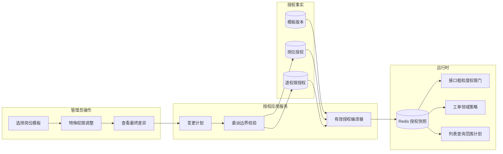

# 授权体系 V2：岗位模板、逐权限例外与统一有效授权

- 状态：已批准；原 `1.0.48` 测试候选按版本治理规则重定为 `2.0.0`，待重新部署测试并由用户终测
- 日期：2026-08-14
- 适用范围：WEB、APP、用户导入导出、工单列表/详情/动作、管理后台和授权委派
- 替代目标：当前 `RoleBundle -> Role -> RolePermissionRule -> MembershipRoleGrant` 的运行时组合模型

## 1. 结论

目标模型采用“岗位模板用于快速配置，逐权限策略用于最终鉴权”：

1. 角色与岗位模板合并为一个用户可理解的概念：**岗位权限模板**。
2. 权限继续拆成原子动作；业务代码只检查权限，不检查角色名称。
3. 给用户应用模板时，只需选择批量生成所用的数据范围和有效期，满足绝大多数人员操作。
4. 模板应用后直接生成显式逐权限授权；特殊人员调整对应来源的单条授权，也可以增加临时直接授权。
5. 岗位模板和授权批次均不拥有运行时数据范围。每条逐权限授权只有一套明确的数据范围、关系条件和有效期。
6. 多个有效允许规则按并集计算；默认拒绝。V2 不引入跨来源的全局 `DENY`，避免下级管理员用一条拒绝覆盖上级授权。
7. 数据范围、人物关系、有效期、工单状态是四个独立条件，最终只取交集。
8. 授权者不能授出高于自己的权限、组织覆盖、关系条件或有效期。
9. 原子权限按独立业务动作拆分：凡是可以独立委派、独立审计、改变领域状态或暴露敏感数据的动作，都必须拥有独立权限编码。

该模型保留 RBAC 便于人员管理的优势，同时通过逐权限数据范围和关系条件解决特殊处理员、跨区县支援、临时授权和权限收窄问题。

## 2. 当前问题

当前系统存在四层概念：

1. `RoleBundle`：岗位模板，应用时展开为多个角色。
2. `Role`：权限集合。
3. `RolePermissionRule.scopeProfile`：权限人物关系或组合条件。
4. `MembershipRoleGrant.dataScope`：整个角色共用的数据范围和有效期。

这会产生以下问题：

- 一个角色内所有权限共用一次数据范围，无法表达“全县可看、仅本部门可接、本人参与才可下载”。
- `scopeProfile` 同时混入人物关系、工单状态和数据范围概念，出现 `CLAIMABLE_OR_PARTICIPANT` 这类组合规则。
- 当前部分 `REPORTER/PARTICIPANT/CURRENT_HANDLER` 判断没有始终与 Grant 组织范围求交，存在关系条件绕过数据面的风险。
- 普通人员需要面对大量细分角色；特殊人员又只能新增角色或叠加角色。
- 用户授权使用整组替换，目标用户存在上级授权时容易把整页锁死，或者误覆盖不可见授权。
- 岗位模板修改是否影响既有人员缺少版本化语义。
- 列表查询与详情鉴权分别拼装范围，容易发生“列表可见但详情 403”或反向不一致。

## 3. 术语

| 中文术语 | 代码建议 | 含义 |
| --- | --- | --- |
| 权限项 | `PermissionDefinition` | 固定目录中的原子动作，例如提交回单 |
| 岗位权限模板 | `AuthorizationProfile` | 可复用的权限规则集合，用户界面不再区分 Role 和 RoleBundle |
| 模板版本 | `AuthorizationProfileVersion` | 已发布模板的不可变快照 |
| 授权批次 | `AuthorizationAssignment` | 记录模板应用、直接授权、导入或迁移的来源和审计信息，本身不参与鉴权 |
| 逐权限授权 | `PermissionGrant` | 用户权限、数据范围、关系条件和有效期的唯一授权事实 |
| 数据范围 | `AuthorizationDataScope` | 可覆盖哪些组织的资源 |
| 关系条件 | `ResourceRelationConstraint` | 用户与资源必须满足的人物关系，不再称为“权限范围” |
| 有效授权 | `EffectivePermissionGrant` | 编译后参与运行时判断的唯一结构 |
| 委派边界 | `DelegationBoundary` | 当前操作者能向下授予的最大能力，不直接授予权限 |

## 4. 设计边界

### 4.1 岗位模板只负责默认值

岗位模板解决“快速配置常见人员”，不是运行时身份判断条件。典型模板包括：

- 网络故障标准处理员
- 箱门未关标准处理员
- 破损箱体更换标准处理员
- 网络故障调度员
- 工单验收员
- 区县管理员标准岗位
- 市公司管理员标准岗位

用户可以同时拥有多个岗位模板，但业务代码不得检查 `ROLE_NETWORK_FAULT_WORKER` 等模板编码。

### 4.2 每条权限只有一套有效规则

岗位模板在应用时展开为显式`PermissionGrant`，运行时快照统一为：

```text
EffectivePermissionGrant {
  permission
  dataScope
  relationConstraint
  validFrom
  expiresAt
  source
}
```

运行时不解释岗位模板、授权批次、角色范围或覆盖规则。

### 4.3 最终判定公式

```text
允许 = 存在至少一条有效授权
    AND 权限名称匹配
    AND 当前时间位于有效期
    AND 资源组织位于数据范围
    AND 用户与资源满足关系条件
    AND 领域状态机允许该动作
```

多个 `ALLOW` 来源按并集计算。不存在允许规则就是拒绝。

## 5. 原子权限设计

每种工单类型使用同一动作目录，例如 `network-fault`：

| 权限动作 | 建议编码后缀 | 可配置关系条件 | 固定领域约束 |
| --- | --- | --- | --- |
| 提单 | `report` | `NONE` | 工单归属用户所属/指定可报组织 |
| 查看列表与基础详情 | `view` | `ANY_IN_SCOPE/REPORTER/PARTICIPANT` | 无额外状态限制 |
| 查看流转记录 | `history:view` | `ANY_IN_SCOPE/REPORTER/PARTICIPANT` | 无额外状态限制 |
| 读取附件 | `attachment:read` | `ANY_IN_SCOPE/REPORTER/PARTICIPANT` | 预览和下载都暴露文件内容，不伪拆两项 |
| 主动接单 | `claim` | `ANY_IN_SCOPE` | 工单未分配且处于可接状态 |
| 接受派单 | `assignment:accept` | `PENDING_HANDLER` | 本人是待接收人 |
| 拒绝派单 | `assignment:reject` | `PENDING_HANDLER` | 本人是待接收人且必须填写原因 |
| 提交回单 | `response:submit` | `CURRENT_HANDLER` | 工单处理中且本人是当前处理人 |
| 挂起处理 | `hold` | `CURRENT_HANDLER` | 工单正在处理且原因必填 |
| 恢复处理 | `resume` | `CURRENT_HANDLER` | 工单已挂起且本人是当前处理人 |
| 首次派单 | `assignment:create` | `ANY_IN_SCOPE` | 目标人员具备对应处理权限 |
| 调整处理人 | `assignment:reassign` | `ANY_IN_SCOPE` | 非终态且并发版本匹配 |
| 验收通过 | `verification:approve` | `ANY_IN_SCOPE/REPORTER` | 待验收且意见必填 |
| 验收驳回 | `verification:reject` | `ANY_IN_SCOPE/REPORTER` | 待验收且意见必填 |
| 验收本人回单通过 | `verification:self:approve` | `RESPONSE_SUBMITTER` | 待验收、本人提交当前回单且意见必填 |
| 验收本人回单驳回 | `verification:self:reject` | `RESPONSE_SUBMITTER` | 待验收、本人提交当前回单且意见必填 |
| 提单撤回 | `withdraw` | `REPORTER` | 尚未进入有效处理阶段 |
| 异常取消 | `cancel` | `ANY_IN_SCOPE` | 非终态且原因必填 |
| 内部审计 | `audit:view` | `ANY_IN_SCOPE` | 可查看完整操作身份和内部字段 |

每类工单固定包含以上 19 个动作。工单状态不能由管理员配置为关系条件；`可接单`、`待验收`、`已挂起`属于领域状态机，不能再出现 `CLAIMABLE_OR_PARTICIPANT` 这类混合策略。

## 6. 关系条件

V2 只保留以下关系：

| 条件 | 含义 |
| --- | --- |
| `NONE` | 不适用资源人物关系，例如创建动作 |
| `ANY_IN_SCOPE` | 数据范围内不追加人物关系 |
| `MEMBERSHIP_ORG` | 资源组织必须是当前用户所属组织，用于非工单资源的组织锚定 |
| `REPORTER` | 本人是提单人 |
| `PARTICIPANT` | 本人是待处理人、当前处理人或历史已接受处理人 |
| `PENDING_HANDLER` | 本人是待接收处理人 |
| `CURRENT_HANDLER` | 本人是当前有效处理人 |
| `RESPONSE_SUBMITTER` | 本人是当前待验收回单的提交人 |

关系覆盖是偏序而不是简单等级：

- `ANY_IN_SCOPE` 可以向下委派任意关系条件。
- `PARTICIPANT` 可以覆盖 `PENDING_HANDLER`、`CURRENT_HANDLER` 和 `RESPONSE_SUBMITTER`。
- `REPORTER` 与 `PARTICIPANT` 不可互相覆盖。
- `PENDING_HANDLER`、`CURRENT_HANDLER` 与 `RESPONSE_SUBMITTER` 不可互相覆盖。
- 需要“本人提单或本人参与”时，保存两条允许规则，禁止新增组合枚举。

## 7. 数据范围

资源关系中的 `REPORTER` 仅表示工单提单人；`PARTICIPANT` 仅表示待接收、当前处理或历史上接受过派单的处理参与者，不包含提单关系。客户端统一显示为“本人提单”和“本人参与处理”，避免把两类关系误解为包含关系。

数据范围使用独立值对象，不再局限于一个 `scopeOrgId`：

```text
AuthorizationDataScope {
  tenantWide
  nodes[] {
    orgUnitId
    includeDescendants
  }
}
```

支持以下用户选项：

- 当前组织
- 当前组织及下级
- 全市租户
- 自定义多个组织；每个组织可单独选择是否包含下级

保存前进行规范化：去重、排序、移除被上级组织树完整覆盖的冗余节点。工单始终使用 `responsible_org_id` 进行数据面判断。

用户调动组织时不自动隐式改变既有授权。组织调整必须进入变更预览，由管理员明确选择：

- 授权锚点随用户迁移
- 保留原授权范围
- 重新选择授权范围

## 8. 特殊处理员

普通处理员应用“网络故障标准处理员”，以南靖县组织树批量生成权限即可保存。特殊处理员可以调整该来源中的具体权限：

| 权限 | 标准配置 | 特殊配置示例 |
| --- | --- | --- |
| 查看详情 | 南靖县组织树 + `ANY_IN_SCOPE` | 南靖县与平和县组织树 |
| 查看流转 | 南靖县组织树 + `PARTICIPANT` | 保持模板 |
| 读取附件 | 南靖县组织树 + `PARTICIPANT` | 停用 |
| 主动接单 | 南靖县组织树 | 仅南靖县本级组织 |
| 接受/拒绝派单 | `PENDING_HANDLER` | 保持模板 |
| 回单/挂起/恢复 | `CURRENT_HANDLER` | 保持模板 |

如果特殊能力不属于模板，可添加一条有明确原因和到期时间的直接授权，例如“7 天内允许调单”。

## 9. 冲突处理

### 9.1 授权来源合并

同一权限由多个授权批次提供时，最终有效数据范围是允许规则并集。界面必须显示来源，不能只显示一个合并后的模糊结果。

### 9.2 来源内调整

模板生成的每条逐权限授权支持：

- 保持：授权行保持模板生成结果。
- 调整：修改该来源授权行的数据范围、关系条件或有效期，并标记为已定制。
- 撤销：只撤销当前授权批次来源的授权行。

撤销不覆盖其他岗位模板、迁移或直接授权来源。如果同一权限仍由其他来源提供，界面必须提示“该权限仍由另一个来源生效”。

### 9.3 不采用全局显式拒绝

V2 不提供普通管理员可创建的全局 `DENY`。原因是低权限管理员不能通过一条拒绝破坏上级授予的权限。需要收回权限时，应撤销或停用自己可管理的授权来源；不可管理的上级来源保持不变。

## 10. 模板版本

岗位模板发布后不可原地修改：

1. 编辑产生草稿版本。
2. 发布产生新的不可变版本。
3. 既有用户继续固定在原版本，不静默增权或减权。
4. 管理员通过“升级授权版本”查看差异、影响人数和越权检查后批量升级。
5. 用户的权限例外按权限编码重放；权限已退役时必须人工处理，不能静默丢弃。

内置模板由版本发布和 Liquibase 迁移统一升级；自定义模板由租户管理员发布。

## 11. 数据模型

### 11.1 模板

- `authorization_profiles`
  - `id` UUIDv7
  - `tenant_id`
  - `code`、`display_name`、`description`
  - `built_in`、`active`
  - `current_version_id`
- `authorization_profile_versions`
  - `id` UUIDv7
  - `profile_id`、`version_no`
  - `status`：`DRAFT/PUBLISHED/RETIRED`
  - `change_summary`
  - `created_by/created_at/published_by/published_at`
- `authorization_profile_permission_rules`
  - `id` UUIDv7
  - `profile_version_id`
  - `permission_id`
  - `relation_constraint`
  - `sort_order`

一个模板版本可以为同一权限保存多个不同关系规则，以表达关系条件的 OR。

### 11.2 用户授权

- `authorization_assignments`
  - `id` UUIDv7
  - `tenant_id`、`membership_id`、`profile_version_id`
  - `source_type`、`source_label`
  - `status`：`ACTIVE/REVOKED`
  - `granted_by_membership_id`、`granted_at`、`revoked_at/reason`
- `permission_grants`
  - `id` UUIDv7
  - `tenant_id`、`membership_id`、`assignment_id`
  - `profile_rule_id`、`permission_id`
  - `data_scope_id`、`relation_constraint`
  - `valid_from`、`expires_at`
  - `customized`、`reason`、`granted_by_membership_id`
  - `status`：`ACTIVE/REVOKED`

`AuthorizationAssignment` 只记录来源和审计边界，不参与运行时裁决。岗位来源与直接来源最终都生成 `PermissionGrant`；单条特殊调整通过撤销原 Grant 并在同一来源下生成 `customized=true` 的新 Grant 实现，不存在第二套 override 解释器。所有 Grant 均独立校验有效期和委派边界。

### 11.3 数据范围

- `authorization_data_scopes`
  - `id` UUIDv7
  - `tenant_id`
  - `tenant_wide`
  - `canonical_hash`
- `authorization_data_scope_nodes`
  - `scope_id`、`org_unit_id`
  - `include_descendants`

`tenant_wide=true` 时不能存在节点；否则至少存在一个节点。`canonical_hash` 用于识别完全相同的不可变范围值。

## 12. 运行时结构



运行时快照建议结构：

```text
Map<PermissionName, List<EffectivePermissionGrant>>
```

快照 key 包含 `tenantId + membershipId + authorizationVersion`。授权事务提交时递增 `authorizationVersion`、事务后清理 Redis；访问令牌中的旧版本在刷新时失效。每次判断仍检查授权到期时间，不能只依赖缓存 TTL。

## 13. 列表与详情一致性

详情鉴权和列表查询必须来自同一组 `EffectivePermissionGrant`：

- 详情：对单个工单执行数据范围、关系条件和状态判断。
- 列表：把相同授权编译为 `WorkOrderVisibilityPlan`，生成租户、工单类型、组织集合和人物关系谓词。
- 不再分别维护 `participantTypes`、`claimableTypes` 等相互独立且可能越过数据范围的逻辑。
- 集成测试必须证明：任一列表结果都能打开详情；任一有详情权限的工单都能通过无额外业务筛选的查询找到。

## 14. 委派边界

授予者必须同时具有：

1. 用户授权管理权限，并覆盖目标用户所属组织。
2. 与目标相同的原子权限。
3. 覆盖目标数据范围的组织并集。
4. 等于或更宽的关系条件。
5. 覆盖目标有效期的连续授权。

例如管理员 B 的权限 A 在 10 天后到期，则其创建的任何权限 A 最晚同一时刻到期，不能通过模板、直接授权或导入绕过。

低权限管理员处理高权限用户时：

- 不显示其无权查看的授权名称和范围，只显示“另有 N 条上级授权”。
- 可以查看自己可管理的授权来源。
- 只能新增、调整或撤销自己边界内的授权来源，提交使用增量操作，不整组覆盖。
- 联系方式、密码、状态和会话等可能接管账号的操作仍需完整覆盖目标账号的最高授权边界。
- `superAdmin` 通过 `SUPER_ADMINISTRATOR` 系统身份获得平台租户与全市最高授权，是唯一能够完整覆盖平台级系统基线的账号。
- 默认 `admin` 通过 `DEFAULT_ADMINISTRATOR` 系统身份获得市公司根组织级管理授权，不自动获得平台租户管理上限。
- 两类系统账号均以 `system_key`、租户根组织关系和不可修改的 `SYSTEM` 授权来源识别；运行时代码不得按用户名、`3506` 或其他组织编码写死。
- 配置中的 bootstrap 口令只用于首次创建；数据库已有账号、口令和主动授权优先于 ENV，应用重启不得重置数据库状态。

## 15. 单用户操作流程

用户详情保持只读，点击“调整授权”进入三步全屏流程。

### 第一步：标准岗位

- 搜索并选择岗位模板。
- 只展示当前管理员能够完整授予的模板。
- 默认范围取目标用户所属组织；管理员可选本组织、组织树、全市或多组织。
- 设置授权有效期；默认不能超过当前管理员上限。

普通用户到此即可保存，无需面对权限矩阵。

### 第二步：特殊调整

- 默认折叠，仅在点击“高级调整”后展示。
- 按系统模块、工单类型分组，不平铺所有权限。
- 每行显示：权限、来源模板、数据范围、关系条件、有效期、最终状态。
- 支持筛选“仅看已启用、仅看特殊调整、即将到期、存在多个来源”。
- 操作为“恢复模板默认、单独调整、停用此来源、增加临时权限”。
- 无权管理的上级来源不显示详情，也不会被当前保存覆盖。

### 第三步：确认变更

- 由服务端重新计算增加、撤销、扩大、缩小和到期变化。
- 扩大数据范围、增加直接权限、延长有效期必须填写原因。
- 显示哪些权限仍由其他来源生效。
- 使用 `expectedAuthorizationVersion + planToken + Idempotency-Key` 提交，过期计划返回 `STALE` 并要求重新预览。

APP 使用同一三步流程的全屏页面；WEB 使用宽屏表格。APP 不提供批量表格导入，但必须支持标准岗位和逐权限特殊调整。

## 16. 岗位模板管理

- 模板编辑器按模块展示权限矩阵，而不是展示多个角色。
- 选择权限后，仅显示该权限允许的关系条件。
- 模板保存为草稿；发布前显示与上一版本的权限差异。
- 发布不自动影响既有用户。
- “升级既有授权”是独立批量任务，先预览受影响用户、越权项和个人覆盖冲突。
- 内置模板不可删除，可复制为租户自定义模板。

## 17. API 契约

### 用户授权

- `GET /admin/users/{id}/authorization`
  - 返回可管理岗位授权、权限例外、直接授权、最终有效权限摘要和隐藏上级授权数量。
- `POST /admin/users/{id}/authorization/plans`
  - 输入增量操作和 `expectedAuthorizationVersion`，只生成预览。
- `POST /admin/users/{id}/authorization/plans/{planToken}/apply`
  - 幂等执行已预览计划。
- `GET /admin/users/{id}/authorization/options`
  - 返回当前管理员对该目标可授予的模板、权限、组织范围、关系条件和最大有效期。

禁止继续使用“提交完整 roleGrants 数组覆盖全部授权”的接口语义。

### 模板

- `GET/POST /admin/authorization-profiles`：查询与创建草稿。
- `PUT /admin/authorization-profiles/{id}/draft`：修改草稿。
- `POST /admin/authorization-profiles/{id}/copy|publish|retire`：复制、发布、退役。
- 模板升级作为用户授权变更计划中的 `UPGRADE_PROFILE` 原子操作执行，先预览差异再幂等应用。

## 18. 用户导入导出

授权 V2 工作簿建议包含：

1. `填写说明`
2. `用户资料`
3. `岗位授权`
4. `权限特殊调整`
5. `临时直接授权`
6. `岗位模板目录`
7. `权限目录`
8. `组织目录`
9. 隐藏 `模板元数据`

主要字段：

- `岗位授权`：手机号、动作、模板编码、数据范围、组织编码集合、有效期。
- `权限特殊调整`：手机号、岗位授权引用、权限编码、`REPLACE/DISABLE`、关系条件、组织范围、有效期、原因。
- `临时直接授权`：手机号、权限编码、关系条件、组织范围、有效期、原因。

普通导入只填写用户资料和岗位授权。特殊人员才填写后两张表。

上传继续使用分片与断点续传；预览分页。授权执行以“单个用户”为事务原子边界，同一用户任一授权行失败时，该用户全部不写入。导出目录和模板必须按操作者委派边界裁剪，不能泄露高权限模板或组织。

## 19. Liquibase 深迁移

### 阶段 A：V2 建模（034-038，已完成）

- 新增 V2 表、约束和索引。
- 将当前权限目录映射为新的原子动作，拆分接受/拒绝派单、挂起/恢复、验收通过/驳回。
- 建立变更计划、组织迁移审计和模板版本升级契约。

### 阶段 B：确定性迁移（034，已完成）

- 内置 RoleBundle 合并为内置岗位模板。
- 当前自定义 Role/RoleBundle 转为租户自定义模板。
- 当前用户 Role Grant 转为岗位授权；每条权限必须显式与原 Grant 数据范围求交。
- 组合关系策略拆成多条规则，禁止保留组合枚举。
- 无法唯一映射的数据进入迁移异常表并阻止启动，不能猜测权限。

### 阶段 C：迁移断言与回归比对（已完成）

- Liquibase 在删除旧结构前断言每条旧用户授权都存在确定性的 V2 assignment。
- 集成测试覆盖内置岗位、区县数据面、工单关系条件和用户导入导出。
- V2 不允许未解释增权；断言失败直接阻止应用启动。

### 阶段 D：单轨切换与旧结构退役（039，已完成代码与 H2 验证）

- 039 在迁移完整性断言通过后删除旧 Grant/RoleBundle/Role 表。
- 应用只读取 V2，不保留运行时 fallback、双写或旧 API。
- 测试环境必须验证真实 MySQL 迁移；生产切换前必须备份数据库，回滚点是迁移前备份与上一版镜像。
- 切换后清理 Redis 授权快照；旧登录响应字段已破坏性退役，APP 本机会话存储版本升级为 `v4` 并要求重新登录。

## 20. 索引与性能

- 所有主键使用 UUIDv7/BINARY(16)。
- 岗位授权索引：`tenant_id,membership_id,status,expires_at`。
- 直接授权索引：`tenant_id,membership_id,permission_id,status,expires_at`。
- 范围节点索引：`scope_id,org_unit_id` 和 `org_unit_id,scope_id`。
- 模板规则按版本一次批量读取，避免 M:N 大 JOIN。
- 授权快照采用 two-phase loading：先读取有效 assignment/direct grant IDs，再批量读取规则、覆盖和范围节点并在应用层组装。
- 搜索查询使用编译后的组织 ID 集合和关系子查询，禁止逐工单回调权限服务。

## 21. 审计与可观测性

每次授权变更记录：

- 操作者、目标用户、租户、来源客户端。
- 变更计划 ID、原因、前后授权规范化摘要和 hash。
- 新增、撤销、扩大、缩小、有效期变化。
- 委派边界校验结果和失败原因。
- 模板版本及个人覆盖来源。

只记录授权标识和范围，不记录密码、令牌、验证码或附件内容。

## 22. 验收矩阵

必须覆盖：

- 标准提单员、处理员、调度员、验收员、管控员、审计员的全流程。
- 特殊处理员扩大查看范围、缩小接单范围、停用附件、临时调单。
- 同一权限多个模板来源的并集与来源停用。
- 区县管理员不能看到或授予市公司管理员模板。
- 10 天权限只能向下授予不超过 10 天的权限。
- 关系条件始终与数据范围求交，跨区县参与记录不能绕过数据面。
- 列表与详情双向一致。
- 用户组织迁移三种策略。
- 模板新版本发布、固定旧版本、批量升级和个人覆盖重放。
- 单用户 WEB/APP 操作及九 Sheet 导入导出。
- 并发编辑返回 `STALE`，幂等重试不重复写入。
- Redis 不可用时按系统既定安全策略处理，不能使用过期授权静默放行。

## 23. 明确不做

- 不引入 OpenFGA、OPA、Casbin 等独立授权服务；当前规模使用 Spring、MySQL、Redis 足够，先把模型和契约做正确。
- 不支持普通管理员创建跨来源全局 `DENY`。
- 不允许业务代码根据角色名、用户名、组织编码或市公司编码放行。
- 不保留旧模型运行时兼容 fallback。
- 不允许模板发布静默修改既有用户权限。

## 24. 已批准并冻结的决策

1. 是否同意将“角色”和“岗位模板”合并为一个用户概念，旧 RoleBundle 不再作为独立运行时层。
2. 是否同意 V2 使用“默认拒绝 + 多条允许并集 + 来源级停用”，不提供普通管理员全局拒绝。
3. 是否同意模板发布不自动影响既有用户，必须通过批量升级计划显式更新。
4. 是否同意用户调动组织时不自动迁移授权，必须在预览中选择处理策略。

以上四项均已批准，并已作为 2.0.0 数据库、API、WEB 和 APP 契约实现。后续变更必须通过新的决策记录，不能恢复旧角色兼容层。

## 25. UI 设计原型

可编辑的本地设计预览位于 [authorization-policy-v2-ui-preview.html](./authorization-policy-v2-ui-preview.html)，包含：

1. [WEB 标准岗位快速配置](./authorization-policy-v2-ui-preview.html)。
2. [WEB 特殊人员逐权限调整](./authorization-policy-v2-ui-preview.html)。
3. [WEB 服务端预检与增量变更确认](./authorization-policy-v2-ui-preview.html)。
4. [APP 对应的三步全屏操作流程](./assets/authorization-v2/app-three-step-flow.png)。

原型遵循以下交互约束：

- 普通人员只需完成“岗位模板 + 默认数据范围 + 有效期”，无需进入权限矩阵。
- 特殊调整按单条权限和授权来源执行，不直接修改模板，也不覆盖其他来源。
- WEB 和 APP 使用同一变更计划、委派边界和最终差异，不各自实现授权规则。
- 所有增权、扩大范围和延长有效期操作在最终确认页集中提示，并要求填写原因。
