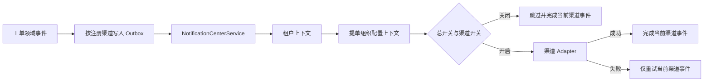

# 通知中心渠道注册与作用域隔离

> 状态：已采纳
> 日期：2026-08-07

## 背景

通知中心已有邮件、企业微信和钉钉实现，也已有“平台默认 -> 市租户覆盖 -> 组织祖先 -> 当前组织”的配置解析，但渠道注册、启停判断、Outbox 渠道枚举和管理界面分别依赖底层配置键。继续增加渠道会要求多处同步修改，容易造成某个区县开关读取错作用域、关闭渠道仍发消息或界面与实际注册渠道不一致。

## 决策

- `NotificationCenterService` 只负责通知用例编排：进入租户、加载工单通知快照、进入提单组织配置作用域并调度选定渠道。
- `NotificationChannelRegistry` 是已注册渠道的唯一目录，启动时校验空名称和重复名称，并向 Outbox、设置 API 和发送编排提供稳定排序后的渠道清单。
- 每个 `NotificationChannel` 通过 `NotificationChannelDescriptor` 声明名称、中文显示名、说明、启用配置键和默认值；adapter 只负责本渠道的配置参数、协议和响应校验。
- `NotificationSwitchPolicy` 集中解释通知中心总开关与渠道开关。开关始终在工单提单组织的 `ConfigurationScopeContext` 内解析，因此同一租户下各区县可独立覆盖，派单或调单不会改变原区县通知策略。
- `NotificationSettingsService` 和 `/admin/notifications/settings` 对管理端提供高层设置契约。前端只识别 `center` 与注册渠道名称，不读取或写入 `notification.*` 底层键。
- Outbox 继续按渠道生成独立事件。一个渠道失败只重试该渠道，不会重发已经成功的其他渠道。

## 隔离与失败语义

- 租户由 `TenantContext` 强制限定；组织覆盖通过显式 `orgUnitId` 管理，并在实际发送时按工单 `reportingOrgUnitId` 解析。
- 邮件收件人由独立 resolver 按提单组织所属区县解析：区县工单选择本区县启用的 `ROLE_COUNTY_ADMIN`，市直属工单选择市级启用的 `ROLE_ADMIN`。显式邮箱优先，未配置邮箱时回退为 `手机号@139.com`。
- 收件人查询使用扁平 projection，只读取用户 ID、手机号和邮箱；租户、组织范围、角色和用户状态必须在查询阶段同时约束。
- 总开关关闭或单渠道关闭属于正常跳过，Outbox 事件完成，不在以后重新补发历史通知。
- 已启用渠道缺少回调地址、收件人或外部调用失败属于配置/传输错误，必须抛出并进入 Outbox 重试与日志告警，禁止静默成功。
- 管理设置 API 只允许注册表内的名称，不能借此写入任意系统配置；仍复用 `system:config:view/update` 和组织数据范围授权。

## 数据与兼容性

- 沿用 `notification.center.enabled`、`notification.email.enabled`、`notification.wecom.enabled`、`notification.dingtalk.enabled`。静态键 `notification.email.recipient.phones` 已退役，由用户联系方式和区县管理员角色动态解析。
- 企业微信和钉钉 adapter 保留在注册表中，但默认关闭且不预置 webhook/secret；本期通过 Liquibase 清理遗留敏感配置。
- 保留既有 `WORK_ORDER_CREATED`、`WORK_ORDER_SLA_BREACHED` 及分渠道事件类型的消费能力，避免部署时遗留 Outbox 事件失效。

## 扩展与回滚

- 新渠道只需实现 `NotificationChannel`、提供 descriptor 与传输测试；注册表、Outbox 和管理设置 API会自动纳入该渠道。
- 回滚应用镜像即可恢复旧编排；数据库和已有配置无需回滚。若新渠道曾产生 Outbox 事件，回滚前应确认该渠道事件已完成或清理，避免旧版本无法识别新事件名称。
