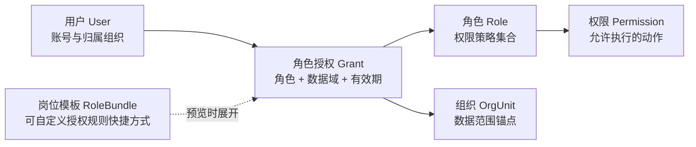

# 用户批量创建、授权与数据域复盘

## 结论

当前 V1 已具备可用的文件传输和基础安全能力，但不适合继续扩展为完整的批量用户治理能力。核心问题不是 Excel 上传下载，而是把“账号资料、岗位模板、角色授权、数据域”压缩在同一行，并由运行时代码推断授权结果。

下一版使用一份版本化工作簿承载三个明确命令域：

1. 批量开户：创建用户事实，可选引用岗位模板产生授权新增命令。
2. 批量资料维护：仅修改明确填写的资料字段，默认不触碰授权。
3. 批量授权调整：以显式 `ADD` / `REMOVE` 命令修改逐条角色 Grant，并明确数据范围、锚点组织和有效期。

岗位模板是可自定义的输入快捷方式，不是最终授权事实。模板必须在预览阶段展开为具体 Grant，管理员确认后持久化为明确角色与数据域。任何阶段都必须满足：

```text
最终可执行范围
  = 请求动作
  ∩ 操作者有效权限
  ∩ 操作者有效数据域
  ∩ 可委派角色和权限策略
  ∩ 目标组织边界
  ∩ 操作者授权有效期上限
```

本报告为设计审查结论，尚未修改现有导入导出业务。

## 当前实现判断

### 已经合理的部分

- 手机号作为全局匹配键，邮箱和账号使用全局唯一约束。
- 租户由登录身份带出，不允许 Excel 指定租户。
- 组织和岗位目录按当前操作者可见范围生成。
- 上传支持分片、断点续传、SHA-256 校验和会话所有权隔离。
- 预览存在任一错误时禁止执行，执行前会重新读取当前数据库状态并重新校验唯一性与授权上限。
- `OrganizationScopeAuthorizationService` 已能校验角色权限策略、Grant 数据域和有效期均不超过授予者。
- 授权变更会递增目标用户 `authorizationVersion` 并清理授权缓存，旧会话会因版本不一致而失效。
- 区县管理员只能看到和导出其组织数据域覆盖的用户、角色和有效 Grant。

### 必须解决的问题

#### P0：资料更新会隐式覆盖授权

V1 每行必须选择一个岗位模板。更新既有用户时，服务端会清空该用户的全部角色和 Grant，再按模板展开结果重建。管理员即使只想修改姓名或邮箱，也会同时替换授权。

这违反“权限动作和资料动作分离”的原则，也是当前最大的误操作风险。

#### P0：数据域由代码猜测，管理员无法表达授权意图

`RoleGrantScopeDefaults` 根据角色类型、岗位模板类型和目标组织是否为租户根组织推导 `ORG`、`ORG_TREE` 或 `TENANT_ALL`。自定义岗位模板只能自定义角色集合，不能自定义每个角色的数据域规则。

因此“自定义岗位模板”目前只完成了一半：管理员能决定授予哪些角色，但不能决定这些角色能看到哪个组织范围。

#### P0：空单元格具有破坏性语义

- 账号状态留空会被解释为 `ACTIVE`，可能把禁用或锁定用户重新启用。
- 邮箱留空会被解释为 `null`，可能清除既有邮箱。
- 岗位模板不能为空，因此无法执行“只维护资料、完全保留授权”。

空值不能同时代表默认值、保持原值和清空。更新模式必须使用 `KEEP` 语义，清空必须使用显式 `#CLEAR`。

#### P0：预览结果没有与执行结果绑定

预览和执行都会重新构建计划，但没有 `previewToken`、输入摘要、用户授权版本或角色目录版本绑定。若预览后岗位模板、角色定义、组织或用户授权发生变化，执行可能应用一套与管理员刚才看到不同、但仍合法的新结果。

执行前重新校验只能防止非法写入，不能证明“执行内容等于已确认内容”。

#### P1：权限要求没有按实际动作计算

当前任何导入都要求同时具备创建用户、修改资料、修改状态、分配角色和查看岗位模板权限。创建专员、资料维护员、状态管理员和授权管理员无法各自执行职责范围内的批量操作。

下一版应按行、按列和按授权动作计算权限并集，而不是为所有任务要求最大权限集合。

#### P1：隐藏高权限授权采用整用户阻断

当前低权限管理员遇到带有不可委派 Grant 的用户时，整行更新会失败。这能防止删除高权限，但也阻止了其权限范围内的普通资料维护。

合理规则应是：

- 资料更新不触碰隐藏 Grant，可以继续执行。
- 授权调整只影响操作者明确可见且可委派的 Grant。
- 预览只显示“隐藏授权保留 N 条”，不泄露角色名称、权限和范围。
- 用户归属组织变更可能影响授权理解，存在隐藏 Grant 时应阻止普通批量迁移，转入独立组织迁移流程。

#### P1：`CUSTOM_ORGS` 并不是真正的组织集合

当前 `CUSTOM_ORGS` 仍只有一个 `scopeOrgId`，权限计算也把它等同于单个 `ORG`。数据库本身允许同一角色存在多个不同组织锚点的 Grant，因此“指定组织集合”应由多条 `ORG` Grant 表达。

深度迁移时应把现有 `CUSTOM_ORGS` 行转换为 `ORG`，删除该枚举，不保留同义兼容层。

#### P1：角色归属存在双事实源

当前 `user_roles` 保存用户角色关系，`membership_role_grants` 又保存相同角色及数据域。所有写路径必须同时维护两份数据，存在漂移风险。

建议以 `membership_role_grants` 作为用户角色分配的唯一事实源：有效角色是有效 Grant 中 `role_id` 的去重集合。权限快照通过 Grant 关联 Role 和 Permission 构建，完成数据规整后删除 `user_roles`，不保留长期双写。

#### P1：导出不适合授权核对

当前导出将所有角色和数据域分别拼进两个多行单元格。区县管理员标准岗位可展开 32 个角色，难以逐条筛选、对比和审计。

导出应至少拆为：

- `用户清单`：一行一个用户，只包含账号资料和归属组织。
- `角色授权`：一行一个有效 Grant，包含手机号、角色编码、角色名称、数据范围、锚点组织、有效期。
- `导出说明`：记录操作者、筛选条件、组织边界、生成时间和脱敏规则。

## 目标领域模型



必须保持以下不变量：

1. `User.orgUnitId` 仅表示人员归属组织，不自动授予任何数据访问权。
2. Role 只定义动作权限和权限关系策略，不携带具体组织。
3. Grant 是角色落到具体用户后的唯一授权事实，必须包含数据范围和有效期。
4. 岗位模板只定义一组可展开的 Grant 规则；修改模板不追溯已发放授权。
5. 一个角色可以对同一用户存在多条不同组织锚点的 `ORG` Grant。
6. 所有授权必须小于或等于授予者在权限策略、数据域和有效期三个维度的交集。

## 岗位模板设计

现有 `role_bundle_roles` 只保存模板和角色关系，应深度迁移为数据驱动的授权规则，例如 `role_bundle_grant_rules`：

| 字段 | 说明 |
|---|---|
| `id` | UUIDv7 |
| `tenant_id` | 租户 |
| `role_bundle_id` | 岗位模板 |
| `role_id` | 角色 |
| `scope_strategy` | `ACCOUNT_ORG` / `ACCOUNT_ORG_TREE` / `TENANT_ALL` |
| `default_duration_days` | 可空，临时授权默认期限 |
| `sort_order` | 预览顺序 |

内置岗位和自定义岗位使用同一数据结构，不再由 `RoleGrantScopeDefaults` 硬编码推导。管理员维护自定义岗位时，需要为每个角色选择默认数据域策略。

模板展开规则：

- `ACCOUNT_ORG`：生成 `ORG + 目标用户归属组织`。
- `ACCOUNT_ORG_TREE`：生成 `ORG_TREE + 目标用户归属组织`。
- `TENANT_ALL`：生成 `TENANT_ALL + 租户根组织锚点`，只允许授予者具备全租户同等权限时使用。
- 展开后保存具体 Grant；后续用户换组织或模板变更均不自动漂移。

## 统一工作簿与批量操作模式

管理员只下载一份 `.xlsx`，同一工作簿既可创建用户，也可更新资料和调整授权。各 Sheet 通过手机号关联，但服务端分别解析为账号命令和 Grant 命令，不能因为同处一个文件而重新耦合。

建议工作表如下：

| 顺序 | Sheet | 可编辑 | 用途 |
|---|---|---|---|
| 1 | `填写说明` | 否 | 解释动作、空值、权限和示例 |
| 2 | `用户资料` | 是 | 一行一个用户，执行开户或字段级资料更新 |
| 3 | `授权调整` | 是 | 一行一条 `ADD` / `REMOVE` Grant 命令 |
| 4 | `岗位模板` | 否 | 可见、可委派的岗位模板目录 |
| 5 | `岗位模板明细` | 否 | 展示每个模板会展开的角色和默认数据域策略 |
| 6 | `角色目录` | 否 | 角色编码、名称、权限摘要和允许的数据域 |
| 7 | `组织目录` | 否 | 组织编码、完整路径和可用范围 |
| 8 | `模板元数据` | 否且隐藏 | 模板版本、租户、操作者、生成时间和目录摘要 |

真正需要填写的只有 `用户资料` 和 `授权调整`。数据域不能从 Grant 中拆到独立可编辑 Sheet，因为“角色 + 数据范围 + 锚点组织 + 有效期”共同构成一条不可分割的授权事实。`岗位模板明细` 是第三张核心业务 Sheet，用于让管理员在填写前看清岗位的真实展开结果。

### 1. `ACCOUNT_CREATE`

在 `用户资料` 中使用 `CREATE` 开户；在 `授权调整` 中按同一手机号使用 `ADD + BUNDLE` 或 `ADD + ROLE` 添加初始授权。若不填写授权行，则创建无角色账号并在预览中高亮提醒，但是否允许执行由系统配置决定。

权限按实际内容计算：

- 创建账号：`user:manage:create`。
- 非默认状态：额外要求 `user:manage:update-status`。
- 含岗位模板或直接授权：额外要求 `user:manage:assign-roles` 和对应可委派能力。

创建失败时账号和 Grant 必须在同一用户段事务内回滚。

### 2. `PROFILE_PATCH`

在 `用户资料` 中使用 `UPDATE` 维护姓名、邮箱、状态等资料。空值默认 `KEEP`，清空邮箱使用 `#CLEAR`。如果同一手机号在 `授权调整` 中没有命令，服务端绝不读取或重建该用户角色。

归属组织迁移不放入普通资料更新。它会影响人员归属和后续默认授权理解，应使用单独的 `ORG_MOVE` 流程并显式处理旧 Grant。

### 3. `GRANT_PATCH`

在 `授权调整` 中每行表达一条命令；目标手机号可以来自本文件新建用户，也可以是系统既有用户：

| 字段 | 规则 |
|---|---|
| 手机号 | 全局用户匹配键 |
| 动作 | `ADD` / `REMOVE`，禁止用空白表示删除 |
| 输入类型 | `BUNDLE` / `ROLE` |
| 岗位模板编码 | `BUNDLE + ADD` 时可用；预览时展开 |
| 角色编码 | `ROLE` 时必填，使用稳定 `Role.name` |
| 数据范围 | `ROLE` 输入时必填：`ORG` / `ORG_TREE` / `TENANT_ALL`；`BUNDLE` 输入由模板明细展开 |
| 锚点组织编码 | 所有范围都使用明确锚点；`TENANT_ALL` 锚定租户根组织 |
| 有效期至 | 可空，不能超过授予者有效期 |

岗位模板只允许用于 `ADD`。`BUNDLE` 行展开后，预览必须逐条显示最终角色、数据范围、锚点组织和有效期，不能只显示“授予 N 个角色”。删除授权必须使用 `ROLE` 并引用明确的角色、数据范围和锚点，避免模板后来变化导致误删。

## Excel 契约

### `用户资料`

字段建议为：`手机号`、`动作(CREATE/UPDATE)`、`姓名`、`所属组织编码`、`登录账号`、`初始密码`、`邮箱`、`账号状态`。一份文件内同一手机号只允许一行用户资料。

- `CREATE`：按开户规则校验必填项；登录账号留空时使用手机号。
- `UPDATE`：空单元格全部表示 `KEEP`；邮箱使用 `#CLEAR` 才能清空；登录账号和手机号不可变更。
- 普通 `UPDATE` 不允许迁移归属组织；组织变化使用独立 `ORG_MOVE` 动作并在预览中展示授权影响。

### `授权调整`

使用一行一个 Grant 命令的纵向结构。一个用户可以出现任意多行，从而分别设置不同角色、组织锚点和有效期。组织、岗位和角色下拉只包含操作者当前可见且可委派的选项。

`ADD + BUNDLE` 是便捷输入，服务端以模板生成时记录的稳定编码解析，并在预览中展开；`ADD/REMOVE + ROLE` 是精细输入。两者可以在同一用户上组合，但展开后出现重复或冲突 Grant 时必须报错，不能按行顺序静默覆盖。

### 只读目录

`岗位模板明细` 必须逐行展示 `岗位模板编码、岗位模板名称、角色编码、角色名称、默认数据域策略、默认期限`。`角色目录` 展示角色的 R/W/RW 类别、权限摘要和可选数据域；`组织目录` 展示组织编码与完整路径，避免同名组织误选。

只读目录应锁定并设置明显底色，不能依赖管理员记忆内部编码。模板元数据隐藏但不作为安全边界；服务端仍以模板版本和目录摘要校验。

### 导出工作簿

导出是只读快照，不直接作为导入文件。系统可提供“按当前筛选生成维护模板”，把用户和可见 Grant 预填到版本化模板中，但仍要求管理员填写显式动作。

## 预览与执行一致性

预览必须固化以下信息：

- 输入文件 SHA-256 和模板版本。
- 操作者、租户、权限快照版本和数据域摘要。
- 角色、岗位模板、组织目录版本摘要。
- 每个目标用户的 `authorizationVersion` 和 `updatedAt`。
- 具体账号变更、Grant 新增/删除及隐藏 Grant 保留数量。

服务端签发短期 `previewToken`，执行时逐项校验。任一事实变化则任务进入 `STALE`，要求重新预览，禁止静默使用新目录重新计算后继续。

## 数据迁移方向

1. Liquibase 新增批量任务、行结果和岗位授权规则表，所有主键使用 UUIDv7。
2. 将现有内置和自定义岗位的角色关系迁移为明确 `scope_strategy`；迁移结果校验后删除 `RoleGrantScopeDefaults`。
3. 将 `CUSTOM_ORGS` 逐行迁移为 `ORG`，删除枚举与客户端选项。
4. 校验 `user_roles` 与有效 Grant 的角色集合完全一致；修复历史不一致后，以 Grant 为唯一事实源并删除 `user_roles`。
5. `membership_role_grants.scope_org_id` 改为所有范围都非空；`TENANT_ALL` 使用租户根组织作为锚点，修复 MySQL 唯一索引中 `NULL` 可重复的问题。
6. 候选环境完成权限、组织、角色、数据域、并发和回滚矩阵后再切换 WEB；不保留 V1/V2 长期双写或隐式兼容。

## 推荐实施顺序

1. 先修领域模型：岗位授权规则、Grant 唯一事实源、数据域枚举收敛。
2. 实现 `ACCOUNT_CREATE` 和 `GRANT_PATCH`，把创建与授权真正分离。
3. 实现 `PROFILE_PATCH` 与独立 `ORG_MOVE`，消除空值和组织迁移歧义。
4. 实现任务化预览、`previewToken`、分页结果和幂等执行。
5. 重做导出为用户清单与逐 Grant 清单，并补充维护模板生成入口。
6. 使用市公司管理员、区县管理员、资料维护员、授权管理员和普通用户完成全角色验收。

完成标准不是“能导入用户”，而是管理员可以在执行前准确回答：将创建哪些账号、每个账号获得哪些角色、每个角色覆盖哪些组织、哪些既有授权会保留或删除，以及为什么当前操作者有权执行这些变化。
