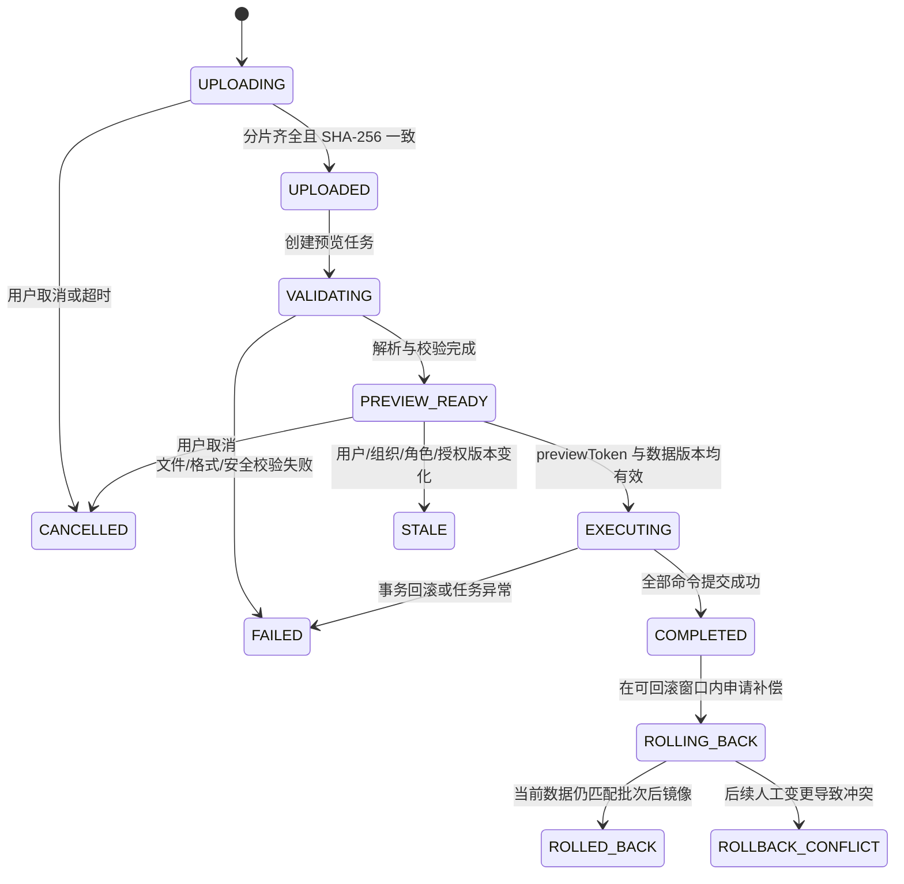
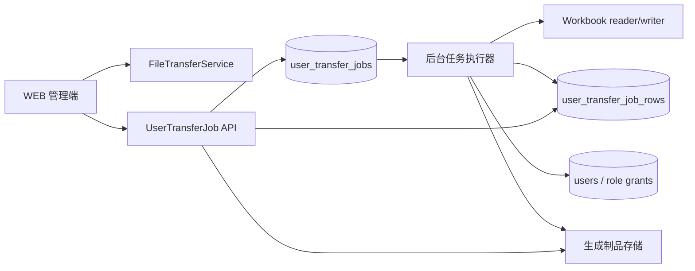

# 用户导入导出与表格 V2 详细设计

> 本设计以当前 `UserImportService`、`UserImportCommandService`、`UserExportQueryService`、`FileTransferService` 和 Apache POI 实现为事实基线。V2 是一次显式契约迁移，不在 V1 同步接口上继续增加兼容分支。生产切换前需要候选环境全量回归和真实 Excel 验收。

## 目标与现状结论

V2 要让管理员安全地完成数百到数万用户的批量维护，并使每个批次都可预览、可追踪、可恢复、可审计。用户资料、账号状态、角色授权属于不同权限面，不能再由一个“岗位模板”字段隐式整体覆盖。

当前实现应保留的能力：

- 手机号作为新增/更新幂等键；手机号、邮箱和登录账号执行全局唯一校验。
- 分片上传、断点续传、Range 分片下载、SHA-256 校验和文件生命周期管理。
- 组织、岗位模板、角色和数据范围基于当前操作者实时权限过滤。
- 预校验不通过时整批禁止执行；数据库命令在单事务内完成。
- 导出只包含操作者有权查看的用户和可委派角色，不包含密码、令牌等凭据。

当前实现需要深度迁移的问题：

| 问题 | 当前影响 | V2 决策 |
|---|---|---|
| 预览与执行各自重新计算计划 | 数据在两次请求间变化时，用户看到的预览不等于实际执行内容 | 预览生成不可变快照和 `previewToken`；执行按快照版本做乐观校验 |
| 岗位模板隐式替换角色 | 管理员难以判断会新增、删除哪些 Grant | 文件只表达授权意图；预览展开为逐 Grant diff |
| 更新既有用户要求一次覆盖资料、状态、授权 | 低权限管理员不能只改资料，也容易被隐藏高权限授权阻断 | 提供三个明确导入模式，权限分别校验 |
| 同步解析与执行 | 大文件会占用 HTTP 线程，失败后无独立任务状态 | 统一异步 `UserTransferJob` 状态机，前端轮询/刷新可恢复 |
| `XSSFWorkbook + byte[]` 全量驻留内存 | 10,000 行导出和大模板会造成 JVM 峰值内存 | 导出采用 `SXSSFWorkbook` 流式写入临时文件，再登记下载制品 |
| 预览一次返回全部行 | 500 行尚可，扩大规模后响应和页面渲染卡顿 | 汇总与行明细分页分离，支持只看错误/变更 |
| 失败只有页面提示 | 难以线下修正并重新导入 | 生成带原始行号、字段、错误码、修正建议的失败报告 XLSX |
| 无批次级审计与撤销 | 无法回答谁在何时批量改了哪些用户 | 保存批次、行结果、字段 diff、Grant diff；有限时间内支持补偿回滚 |

## 业务契约

### 导入模式

管理员在上传前必须选择模式，模式写入任务且不可在预览后更改。

| 模式 | 可写字段 | 既有授权处理 | 所需权限 |
|---|---|---|---|
| `PROFILE_ONLY` 仅资料 | 姓名、手机号匹配键、邮箱、所属组织 | 全部保留 | `user:manage:update-details` |
| `ACCOUNT_STATE` 账号状态 | 启用、停用、禁用、锁定 | 全部保留 | `user:manage:update-status` |
| `ROLE_PATCH` 授权调整 | 岗位模板或显式角色动作 | 仅修改操作者可见且可委派的 Grant；隐藏 Grant 永远保留 | `user:manage:assign-roles` + `role-bundle:manage:view` |
| `CREATE_OR_UPDATE` 新增/综合维护 | 新增用户全部必填项；既有用户按列级动作执行 | 资料/状态/授权分别按权限执行 | 所涉及能力的权限并集 |

不提供“全量覆盖所有授权”给普通管理员。市公司安全管理员若需要全量替换，也必须通过显式 `ROLE_PATCH` 动作逐项删除，不能用空单元格表达删除。

### 授权表达

岗位模板仍作为管理员友好的快捷输入，但它只是预览阶段的展开源，不是数据库事实。授权工作表每行表达一项动作：

| 列 | 含义 | 规则 |
|---|---|---|
| 手机号 | 关联用户 | 必填，与用户工作表手机号一致 |
| 动作 | `ADD` / `REMOVE` | 必填；不允许用留空猜测意图 |
| 岗位模板 | 批量展开角色 | 与角色编码二选一 |
| 角色编码 | 单个角色 | 使用稳定 `Role.name`，显示名只作提示 |
| 数据范围 | `ORG` / `ORG_TREE` / `TENANT_ALL` | 必填且必须在角色允许范围内 |
| 范围组织编码 | 数据范围锚点 | `ORG`/`ORG_TREE` 必填 |
| 有效期至 | 临时授权 | 可空，必须是未来时间 |

预览结果必须展示：角色中文名、动作、数据范围、原授权、目标授权、岗位模板来源，以及“隐藏授权已保留 N 条”。低权限管理员永远看不到隐藏角色名称、权限或范围。

### 唯一键与空值语义

- 手机号是导入匹配键，不允许在同一任务内重复；修改手机号不通过普通导入完成，使用独立身份变更流程。
- 邮箱非空时全局唯一；空单元格默认 `KEEP`，显式清空使用专用值 `#CLEAR`。
- 登录账号只在新增时可设置，留空等于手机号；既有用户禁止通过导入修改。
- 空单元格不再同时承担“保留”“清空”“删除授权”三种含义。
- 所有 Excel 文本按 NFKC、去首尾空白处理；手机号、账号、组织编码、角色编码强制文本格式，避免科学计数法和前导零丢失。

## 状态机与处理架构



`UserTransferJob` 是导入、导出和失败报告的统一任务聚合。HTTP 接口只创建任务、分页查询结果和获取制品，不在请求线程中执行整批解析或工作簿生成。



### 快照与并发控制

- 预览记录 `inputSha256`、模板版本、操作者、租户、管理组织范围摘要、角色目录版本、岗位模板版本和每个目标用户 `authorizationVersion + updatedAt`。
- `previewToken = HMAC(serverSecret, jobId + previewVersion + snapshotHash + expiresAt)`，有效期 30 分钟。
- 执行前重新读取所有涉及用户和 Grant 的版本；任一不一致则任务转为 `STALE`，要求重新预览，绝不静默重算后继续。
- 同一用户同时只能有一个 `EXECUTING` 的用户导入任务。数据库使用按 membership id 排序的悲观锁，避免不同批次锁顺序造成死锁。
- 创建用户依赖手机号/邮箱/账号唯一索引兜底；冲突转换为明确行错误，不向前端泄露其他租户用户信息。

### 事务与分批

- 每段最多 500 用户，段内原子；任务保存段状态和 before/after diff。即使任务少于 500 行也沿用相同分段执行器，避免维护两套提交语义。
- 任一分段失败即停止后续段，任务进入 `FAILED_PARTIAL`；Worker 自动按逆序补偿此前成功分段。补偿全部成功后进入 `FAILED_ROLLED_BACK`，存在并发冲突时进入 `ROLLBACK_CONFLICT` 并要求人工处理。
- UI 执行前明确显示分段数和自动补偿规则；不向管理员提供可能误解为“全文件单事务”的选项。
- 事务内只包含数据库读取/写入和授权版本递增；文件 I/O、XLSX 解析、密码散列预计算、制品生成均在事务外完成。

## 数据模型

所有主键使用 UUIDv7，Liquibase 分 MySQL/H2 建表。

### `user_transfer_jobs`

| 字段 | 说明 |
|---|---|
| `id` | UUIDv7 主键 |
| `tenant_id` / `operator_membership_id` / `operator_org_unit_id` | 租户、操作者和发起组织 |
| `job_type` | `IMPORT` / `EXPORT` / `ERROR_REPORT` / `ROLLBACK` |
| `import_mode` | 导入模式；非导入任务为空 |
| `status` / `progress_percent` / `processed_rows` / `total_rows` | 状态与进度 |
| `input_file_id` / `output_file_id` / `error_file_id` | 分片文件和生成制品 |
| `input_sha256` / `template_version` | 输入身份与模板契约 |
| `preview_version` / `snapshot_hash` / `preview_expires_at` | 预览快照 |
| `filter_json` | 导出筛选条件的规范化 JSON |
| `summary_json` / `failure_code` / `failure_message` | 汇总和受控错误 |
| `created_at` / `started_at` / `completed_at` / `expires_at` | 生命周期时间 |
| `version` | 乐观锁版本 |

### `user_transfer_job_rows`

| 字段 | 说明 |
|---|---|
| `id` / `job_id` / `row_number` | 行身份和原 Excel 行号 |
| `target_membership_id` / `phone_hash` | 目标用户与受保护手机号摘要 |
| `action` / `result_status` | `CREATE` / `UPDATE` / `UNCHANGED` / `ERROR` |
| `field_diff_json` / `grant_diff_json` | 脱敏前后差异；隐藏 Grant 只记录数量 |
| `error_codes_json` / `error_messages_json` | 稳定错误码和中文提示 |
| `before_version` / `after_version` | 并发与回滚依据 |

审计表不保存初始密码明文。新增用户密码只存在于解析任务内存，散列后立即丢弃；失败报告也不回写密码。

## API 契约

| 方法与路径 | 用途 |
|---|---|
| `POST /admin/user-transfer/import-template` | 按模式和当前权限生成版本化模板任务 |
| `POST /admin/user-transfer/imports` | 创建导入任务并返回分片上传会话 |
| `POST /admin/user-transfer/imports/{jobId}/preview` | 异步开始预览 |
| `GET /admin/user-transfer/jobs/{jobId}` | 查询状态、汇总、进度和制品 |
| `GET /admin/user-transfer/jobs/{jobId}/rows` | 分页查询行结果，支持 action/error 筛选 |
| `POST /admin/user-transfer/imports/{jobId}/execute` | 提交 `previewToken` 执行 |
| `POST /admin/user-transfer/jobs/{jobId}/cancel` | 取消未执行任务 |
| `POST /admin/user-transfer/imports/{jobId}/rollback` | 在窗口内创建补偿任务 |
| `POST /admin/user-transfer/exports` | 使用当前列表筛选创建异步导出 |
| `GET/HEAD /admin/user-transfer/files/{fileId}` | Range 下载生成制品 |

所有写接口要求 `Idempotency-Key`。重复提交相同 key 返回原任务；相同 key 配不同请求体返回 `409`。

## Excel 文件契约

### 导入模板

模板版本写入自定义文档属性和隐藏的 `模板元数据` 工作表，不能只靠文件名判断。

| 工作表 | 内容 |
|---|---|
| `填写说明` | 第一张，说明模式、空值语义、限制和示例 |
| `用户资料` | 手机号、姓名、组织、账号、初始密码、邮箱、状态及列级动作 |
| `授权调整` | 显式 `ADD/REMOVE`、岗位模板/角色、数据范围和有效期 |
| `组织目录` | 当前操作者可管理的组织，含编码和完整路径 |
| `岗位模板` | 当前操作者可见且可委派的自定义岗位模板 |
| `角色目录` | 可委派角色编码、中文名、R/W/RW、支持的数据范围 |
| `模板元数据` | 隐藏，含 `templateVersion`、tenant、operator、generatedAt、mode 和目录摘要 |

表格规范：

- 最大录入行通过 Excel Table 管理，不预绘制数万空白行；数据验证使用命名范围和结构化引用。
- 必填列使用一致标识，冻结标题行，开启筛选；错误示例使用单独说明区，不在真实数据区放占位数据。
- 手机号、账号、组织编码、角色编码、密码均设置文本格式；时间使用 `yyyy-mm-dd hh:mm`。
- 批注作者必须唯一且非空；生成后执行 OOXML relationship、content type、defined name、data validation 和 comment author 校验。
- 禁止宏、外部链接、OLE、DDE、外部工作簿关系和公式。导入单元格以 `=`、`+`、`-`、`@` 开头时按文本处理并在预览标记。

### 导出工作簿

- `用户数据` 只保存一行一个用户的稳定资料，便于筛选和二次统计。
- `角色授权` 使用一行一个 Grant，避免把多个角色和范围用换行塞入单元格。
- `导出说明` 记录筛选、数据边界、导出人、导出时间和脱敏规则。
- 使用 `SXSSFWorkbook` 和临时文件流式写出，窗口 200 行；每 5,000 行刷新进度。
- 导出结果超过 Excel 单表限制时按组织/批次拆分 sheet；超过可配置上限时生成多个 XLSX 后打包 ZIP，ZIP 本身走 Range 下载。
- 所有以公式触发字符开头的文本前置安全转义，防止 CSV/Excel formula injection。

## 文件与资源安全

- 上传扩展名、MIME 和 ZIP 魔数三重校验；拒绝加密工作簿、宏工作簿和非 XLSX 内容。
- 配置 Apache POI `ZipSecureFile` 的 inflate ratio、单 entry 大小和最大文本量；工作表数、共享字符串数、关系数、批注数和图片数均设上限。
- 上传总大小默认 20 MiB，单分片 2 MiB；行上限默认 20,000，可按租户配置但必须有全局上限。
- 解析在受限后台线程池执行，单任务 2 分钟软超时；5 分钟后通过 Worker 租约超时与协作取消回收任务。Java 线程不做不可靠的强制终止，任何数据库写入都受短事务和任务状态 CAS 保护。
- 任务、上传文件、预览和导出制品均按租户/操作者校验；生成路径不接收用户提供目录片段。
- 原始导入文件默认保留 7 天，导出文件 24 小时，审计 diff 180 天；清理由定时任务幂等执行。

## 权限面与数据面

权限决定“可以执行哪种动作”，数据面决定“可以看见和影响哪些用户/组织/Grant”，最终能力取两者交集，并且不得超过授予者：

```text
effectiveRows = requestedRows
  ∩ operator.permissionCapabilities
  ∩ operator.dataScope
  ∩ delegableRoles
  ∩ delegableGrantScopes
  ∩ targetOrganizationBoundary
```

- 模板、预览、执行、导出四个阶段都重新使用同一 `OrganizationScopeAuthorizationService` 决策，不在 Controller 或 Excel parser 复制权限逻辑。
- 市公司管理员可按其 Grant 查看全市；区县管理员只能看到本组织树。
- 不能通过导入创建比操作者更高权限、更大数据范围或更长有效期的授权。
- 导出隐藏授权时只显示“另有 N 条不可见授权”，不显示名称；导入永远不删除这些授权。
- 执行后递增受影响用户 `authorizationVersion`，撤销其活跃会话并清理 Redis 授权快照。

## 前端交互

- 用户管理页提供“导入”“导出任务”入口；导入采用四步 Stepper：选择模式与下载模板、上传、预览、执行结果。
- 预览顶部展示新增/更新/无变化/错误、资料变更数、授权新增/删除数和隐藏授权保留数。
- 行明细采用服务端分页和虚拟列表，默认只看错误；支持按手机号、动作、组织和错误码过滤。
- 刷新或关闭页面后通过任务中心继续查看，不丢失上传/预览/执行状态。
- 执行按钮必须勾选确认，文案明确显示会影响的用户数和授权数；若预览过期或变为 `STALE`，按钮禁用并提示重新预览。
- 导出使用当前筛选条件创建任务，完成后通知中心提示下载；页面不保持 120 秒同步等待。
- 用户导入、导出、任务查看和制品下载仅在 WEB 管理端提供；APP 不增加入口、页面或批量用户 API 调用。

## 可观测性与审计

- 指标：任务数量、排队时间、解析时长、执行时长、行吞吐、失败率、回滚冲突率、文件大小、导出内存峰值。
- 日志仅记录 `jobId`、tenant、operator、行数、状态和稳定错误码，不记录手机号、邮箱、密码和 Excel 原始行内容。
- 审计事件：`USER_IMPORT_CREATED`、`PREVIEWED`、`EXECUTED`、`FAILED`、`ROLLED_BACK`、`USER_EXPORT_CREATED`、`DOWNLOADED`。
- 运行诊断只采集客户端任务操作、请求编号和失败码，不上传用户表格内容。

## 迁移与回滚

1. Liquibase 新增任务与行表、索引和状态约束，不修改现有用户事实表。
2. 候选环境部署 Worker 与 V2 API，先只对市公司安全管理员开放 feature flag。
3. 使用 10/500/5,000/20,000 行、不同权限角色和冲突数据完成压力与边界验收。
4. 切换 WEB 到 V2；V1 端点进入只读退役窗口，不再创建新任务。
5. 观察 7 天后删除 V1 Controller/DTO/同步生成路径，不保留长期双实现。

回滚只需关闭 V2 feature flag 并切回上一前后端镜像；新任务表为旁路数据，不影响用户事实。若某批次已执行，应用回滚不能撤销业务数据，必须使用该批次的补偿回滚或数据库备份，不能直接删除任务记录。

## 验收矩阵

- 权限：市公司/区县、资料/状态/授权单权限、隐藏高权限、越权组织、超范围 Grant。
- 数据：新增、更新、无变化、全局手机号/邮箱/账号冲突、并发修改、用户被删除、组织/模板被停用。
- 文件：中文文件名、Office/WPS/LibreOffice、批注、下拉、20,000 行、ZIP bomb、外部链接、公式注入、损坏 OOXML。
- 任务：刷新恢复、重复提交、取消、超时、Worker 重启、分段失败、制品过期、Range 重试和 SHA 不一致。
- 回滚：完整回滚、部分段回滚、后续人工变更冲突、会话与授权缓存失效。
- 性能：API P95、Worker 队列、JVM 堆峰值、数据库批量查询次数、临时磁盘和制品清理。

完成标准是候选环境全矩阵通过、真实 Excel 无修复提示、20,000 行导入/导出不阻塞 HTTP 线程且内存可控、权限与数据范围无越界，然后才允许生产部署。
