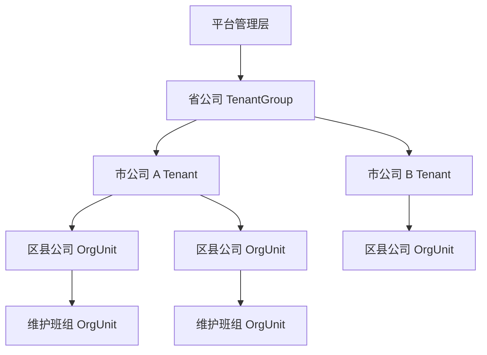
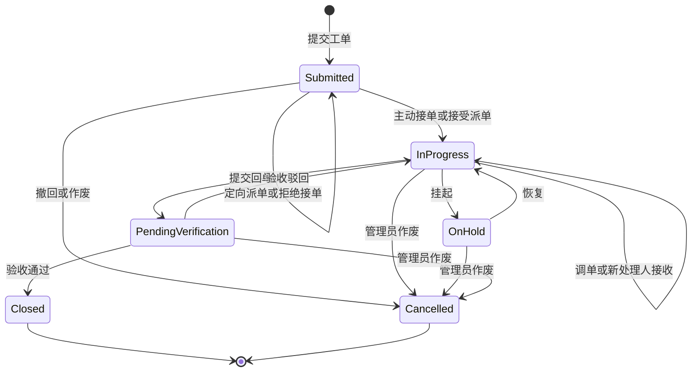

# 工单生命周期、多租户与权限详细设计

> 文档状态：生命周期、多租户、组织权限、配置通知隔离、细粒度岗位、SLA 和 UUIDv7 主键已于 2026-08-07 投产；省级跨市能力继续按本文演进  
> 决策日期：2026-08-06  
> 适用范围：后端、Web、Android App、共享工单目录、认证授权、数据库、缓存、附件、通知与统计  
> 重要说明：本文同时保留目标态设计和已投产契约。生产当前使用六状态生命周期、漳州市默认租户、组织数据范围、细粒度角色、SLA、UUIDv7 与 Liquibase；省级跨租户汇总和跨市关联工单仍属于后续阶段。

## 0. 实施状态（2026-08-06）

本轮已投产以下能力：

- 工单主状态统一为 `SUBMITTED / IN_PROGRESS / PENDING_VERIFICATION / ON_HOLD / CLOSED / CANCELLED`，并提供主动接单、定向派单、拒绝/接受、调单交接、回单、验收通过/驳回、挂起/恢复和取消动作。
- 漳州市公司为默认 `Tenant`，福建省公司为 `TenantGroup`；漳州 4 个市辖区和 7 个县作为市租户下的 `COUNTY` 组织节点。
- 授权拆为固定权限、角色和 `SELF / ASSIGNED / ORG / ORG_TREE / CUSTOM_ORGS / TENANT_ALL` 数据范围；市管理员与区县管理员的管理边界分别在后端强制执行。
- 账号、工单、附件、物料、上传会话、缓存、幂等记录和 Outbox 均带租户边界；配置与通知按平台默认、市租户覆盖、组织树继承解析。
- Web 与 Android 已切换到新状态和服务端 `allowedActions`；Android `1.0.28`（code 29）已发布并强制淘汰数值 ID 客户端。
- 数据库通过独立 Liquibase Job 从存量结构完成迁移，应用使用 `ddl-auto=validate`；全部技术主外键为 MySQL `BINARY(16)`，新实体由 Hibernate 生成 UUIDv7。
- SLA 策略、阶段计时、挂起、驳回重计时、一次性超时事件、Outbox 通知和历时仪表盘均已投产。
- 旧数值主键、数字路由、旧 JWT、旧角色/权限和工单乡镇/村字段已完成 contract 清理，不保留运行时双轨兼容。

仍按目标态保留、未在本轮宣称完成的范围：省级跨市明细监督、跨市关联工单，以及所有生命周期事件的差异化通知对象。

## 1. 设计结论

本次设计在现有统一 `WorkOrder` 聚合上演进，不为普通故障、未关箱、箱体破损换箱建立平行流程。三类工单继续通过 `WorkOrderType` 区分，并共享生命周期、派单、接单、验收、审计、多租户和数据范围规则；类型专有的报单字段与回单校验仍由类型规则负责。

本设计采用的核心决策如下：

| 主题 | 决策 |
| --- | --- |
| 默认租户 | 一个市公司是一个 `Tenant`，数据在市公司之间硬隔离 |
| 省级关系 | 省公司建模为 `TenantGroup` 监督层，不把多个市公司的业务数据合并成一个普通租户 |
| 市内组织 | 区县、部门、维护单位、班组使用 `OrgUnit` 组织树表达 |
| 主动接单 | 具有对应工单类型 `claim` 和 `respond` 权限、且数据范围覆盖工单的人员可以抢接未分配工单 |
| 派单 | 具有对应类型 `assign` 权限的人员可以把未分配工单派给符合处理资格的具体人员 |
| 调单 | 具有对应类型 `reassign` 权限的人员可以调整当前处理人，所有调整必须填写原因并进入审计事件 |
| 派单接收 | 定向派单需要目标人员接受或拒绝；主动抢单直接形成已接受责任派单 |
| 调单交接 | 调单目标接受前保留原责任人，接受时才原子切换，避免无人负责窗口 |
| 验收闭环 | 只有具有对应类型 `verify` 权限且数据范围覆盖工单的人员可以通过或驳回回单 |
| 报单与验收 | `report` 与 `verify` 保持两个独立权限，但默认“一线提单验收角色”同时包含二者 |
| 职责分离 | 处理人默认不能验收自己的回单；租户管理员紧急覆盖必须填写原因并审计 |
| 管理员 | 当前 `ROLE_ADMIN` 演进为租户管理员，拥有所在市租户的全部业务及管理权限，不自动获得跨租户数据权限 |
| 数据迁移 | 统一使用 `Liquibase`；生产停止依赖 Hibernate `ddl-auto=update` |
| 工作流引擎 | 首期使用固定领域状态机和显式动作权限，不引入 BPMN 或租户自定义状态拓扑 |

其中，市公司默认租户、处理角色主动接单、派调单到具体合格人员、独立闭环验收权限、报单与验收默认绑定、管理员具备闭环权限及使用 Liquibase，均来自本轮业务确认。省级 `TenantGroup`、派单接收确认、交接式调单、处理验收职责分离、共享 schema 和分阶段发布属于本详细设计的工程补充项，需要在进入实现计划前完成评审。

实施前约束来源（历史基线）：

- [统一工单领域抽象](../decisions/work-order-domain-abstraction.md)规定只保留一个 `WorkOrder` 聚合。
- [统一工单查询](../decisions/unified-work-order-query.md)规定列表可见范围在数据库查询阶段计算，并保持单一查询入口。
- [管理平面权限边界](../decisions/admin-management-plane-boundary.md)规定前端隐藏不是安全边界，后端必须执行最终授权。
- 实施前 [`WorkOrderStatus`](../../e-report-backen/src/main/java/com/pro/ereportbacken/model/pojo/WorkOrderStatus.java)只有“待处理、已解决、已关闭”；现已扩展为六状态并保留旧字段映射。
- 实施前 [`PermissionCatalog`](../../e-report-backen/src/main/java/com/pro/ereportbacken/security/PermissionCatalog.java)只有报单、查看、回单、下载和全局关闭权限；现已增加接单、派单、调单、挂起、取消和按类型验收权限。
- 实施前 [`AuthTokenService`](../../e-report-backen/src/main/java/com/pro/ereportbacken/security/AuthTokenService.java)令牌只绑定用户名；现有 token v2 已绑定租户、成员和授权版本。

## 2. 目标与非目标

### 2.1 目标

- 为工单提供明确、可验证、不可越级的完整生命周期。
- 同时支持处理人员主动抢单和调度人员定向派单。
- 派单、调单、接单、回单、验收、驳回、挂起和取消均可审计。
- 将“能做什么”“能看哪里”“与该工单是什么关系”拆成独立授权维度。
- 以市公司为租户实现数据库查询、账号、附件、缓存、通知、统计和异步任务的端到端隔离。
- 支持省公司在明确授权下汇总下属市公司数据，同时避免产生隐式跨租户写权限。
- 通过 `Liquibase` 采用 expand/backfill/enforce/contract 方式兼容迁移现有数据与客户端。
- 为高并发抢单、重复移动网络请求和人员权限变更提供一致性保护。

### 2.2 非目标

- 不在本设计阶段修改任何源码、数据库、配置或生产运行态。
- 不允许在不同市租户之间直接转移同一张工单。
- 不为每个区县建立独立数据库或独立租户。
- 不允许租户管理员自动成为省级或平台管理员。
- 不通过前端菜单隐藏代替后端数据隔离。
- 不让租户动态增加任意权限编码或任意状态；权限目录和状态拓扑由平台版本控制。
- 不在同一变更中重命名现有物理表 `fault_reports`，避免把领域演进与低收益在线表重命名绑定发布。

## 3. 租户、组织与行政区划

### 3.1 术语

| 术语 | 含义 | 是否安全边界 |
| --- | --- | --- |
| `TenantGroup` | 省公司或上级监督单位，用于组织市租户、汇总和受控监督 | 是跨租户授权边界，但不直接拥有市公司工单 |
| `Tenant` | 默认对应一个市公司，是业务数据的硬隔离边界 | 是 |
| `OrgUnit` | 市租户内的区县、部门、维护单位、班组组织树 | 是租户内数据范围边界 |
| `AdministrativeRegion` | 工单发生地的省、市、区县、乡镇行政区划编码 | 否，不能单独决定权限 |
| `Identity` | 自然人或统一身份主体 | 否 |
| `TenantMembership` | 某个身份在指定市租户内的账号、组织、状态 | 是账号授权主体 |
| `Role` | 一组固定动作权限的租户内角色 | 否，必须结合角色授权范围 |
| `RoleGrant` | 将角色授予租户成员，并绑定数据范围 | 是 |

### 3.2 层级关系



边界规则：

1. 工单创建后，其 `tenant_id` 永久不变。
2. 工单发生地可以位于租户行政区域之外，但不能因此自动改变工单所属租户。
3. 市内调单可以修改 `responsible_org_id` 和处理人，但不能修改 `tenant_id`。
4. 跨市协作需要在目标市租户创建关联工单，使用 `source_work_order_ref` 建立引用；不得把原工单直接迁移到另一租户。
5. 省级汇总通过带 `tenant_id` 的聚合读模型完成；省级账号查看明细时必须选择目标市租户并获得对应监督授权。
6. 省级或平台令牌不得直接调用普通市租户写接口。需要代办时，必须进入目标租户上下文并留下授权来源和审计记录。

### 3.3 租户内数据范围

数据范围绑定到每一条角色授权，而不是绑定到用户全局。一个用户可以同时拥有“本区县派单”和“全市只读统计”，两种范围不能互相放大。

| 范围 | 含义 | 典型用途 |
| --- | --- | --- |
| `SELF` | 本人提交、本人执行或本人被指派的工单 | 一线提单者、处理人员 |
| `ASSIGNED` | 当前或历史上明确指派给本人的工单 | 处理角色 |
| `ORG` | 指定组织节点本级工单 | 单一部门岗位 |
| `ORG_TREE` | 指定组织节点及所有下级组织工单 | 区县主管、市调度员 |
| `CUSTOM_ORGS` | 明确选择的一组组织节点 | 跨区联合维护组 |
| `TENANT_ALL` | 当前市租户全部工单 | 租户管理员、全市调度中心 |

授权计算必须按“权限编码 -> 对应数据范围集合”执行，禁止先合并出一个用户最大范围再套用到所有权限。

### 3.4 数据库存储拓扑

首期采用共享 MySQL database/schema 的行级租户模型，所有租户业务行强制保存 `tenant_id`。选择该方案的原因是市租户数量可控、统一升级和统计成本较低，同时区县只是市租户内组织，不应产生每区县独立 schema 的运维负担。

MySQL 不提供可直接依赖的原生行级安全策略，因此必须同时设置三层保护：

1. Repository 和 Query Repository 统一从 `TenantContext` 注入租户谓词，业务代码不能自行选择是否添加。
2. 子表使用带 `tenant_id` 的复合外键和 tenant-first 唯一约束，阻止跨租户关联落库。
3. 自动化测试对搜索、详情、统计、附件、缓存、上传和异步任务逐一执行跨租户泄漏用例。

如个别市公司未来因合同或合规要求需要物理独享数据库，可以使用相同 schema 和 Liquibase changelog 部署独立数据源；该能力属于部署拓扑扩展，不改变 `Tenant` 领域边界，也不允许跨数据库业务事务。

## 4. 工单生命周期

### 4.1 主状态

正式工单定义 6 个主状态。`ON_HOLD` 可由租户配置关闭，但状态拓扑本身保持固定。

| Code | 中文 | 含义 | 是否终态 |
| --- | --- | --- | --- |
| `SUBMITTED` | 已提交 | 工单已生效，尚未完成首次接单 | 否 |
| `IN_PROGRESS` | 处理中 | 已进入处理阶段，可能正在处理、等待调单接收或等待重新接单 | 否 |
| `PENDING_VERIFICATION` | 待验收 | 处理人员已提交一轮回单，等待有权限人员验收 | 否 |
| `ON_HOLD` | 已挂起 | 因物料、停电、外协、天气等原因暂停处理 | 否 |
| `CLOSED` | 已闭环 | 验收通过，正常终态 | 是 |
| `CANCELLED` | 已取消 | 重复、误报、撤回或管理员作废，异常终态 | 是 |

状态值在数据库中只存英文 code，中文名称由服务端目录返回。`CLOSED` 和 `CANCELLED` 不允许回到活动状态；故障复发时新建关联工单。

`DRAFT` 不属于正式工单状态。未来若提供草稿能力，应使用独立草稿资源；草稿不生成正式工单编号、不启动 SLA，也不进入调度和统计。

### 4.2 派单子状态

派单状态与主状态分离，避免一个 `status` 同时承载业务进度和责任归属。

| Code | 含义 | 活动槽位语义 |
| --- | --- | --- |
| `PENDING_ACCEPTANCE` | 调度已指派，等待目标人员接单或拒单 | 占用待接收槽位，不替换当前责任人 |
| `ACCEPTED` | 目标人员已接单并承担处理责任 | 占用当前责任槽位 |
| `COMPLETED` | 处理人员已回单，本次派单正常结束 | 否 |
| `REJECTED` | 目标人员拒绝接单 | 否 |
| `REVOKED` | 调度撤回或调单替换 | 否 |
| `CANCELLED` | 工单取消导致派单结束 | 否 |

没有当前责任派单和待接收派单时视为 `UNASSIGNED`，不额外保存一条空派单。数据库必须保证一张工单最多存在一条 `CURRENT` 责任派单和一条 `PENDING` 待接收派单。

### 4.3 用户可见阶段

客户端可以根据主状态、当前责任槽位和待接收槽位显示更贴近业务的阶段，但接口契约必须分别返回这些 code，不能把调单期间的两个人压缩成一个派单状态。

| 主状态 | `CURRENT` 责任槽位 | `PENDING` 待接收槽位 | 页面展示 |
| --- | --- | --- | --- |
| `SUBMITTED` | 无 | 无 | 待接单 |
| `SUBMITTED` | 无 | `PENDING_ACCEPTANCE` | 已派单，待接收 |
| `IN_PROGRESS` | `ACCEPTED` | 无 | 处理中 |
| `IN_PROGRESS` | `ACCEPTED` | `PENDING_ACCEPTANCE` | 调单中，原处理人继续负责 |
| `IN_PROGRESS` | 无 | 无 | 原处理人失效，待重新接单或派单 |
| `IN_PROGRESS` | 无 | `PENDING_ACCEPTANCE` | 原处理人失效，待新处理人接收 |
| `ON_HOLD` | `ACCEPTED` | 无或 `PENDING_ACCEPTANCE` | 已挂起；存在待接收人时同时显示调单标记 |
| `PENDING_VERIFICATION` | 无 | 无 | 待验收；最近责任派单已 `COMPLETED` |
| `CLOSED` | 无 | 无 | 已闭环 |
| `CANCELLED` | 无 | 无 | 已取消 |

### 4.4 状态流转图



### 4.5 动作与守卫条件

| 动作 | 前置状态 | 必需权限 | 关键守卫 | 结果 |
| --- | --- | --- | --- | --- |
| 提交 `SUBMIT` | 无 | `{type}:report` | 当前租户和组织有效；类型字段校验通过 | 创建 `SUBMITTED` 工单和提交事件 |
| 主动接单 `CLAIM` | `SUBMITTED` 或 `IN_PROGRESS`，且无 `CURRENT/PENDING` 派单 | `{type}:claim`、`{type}:respond` | 权限范围覆盖责任组织；原子抢占成功 | 创建 `CURRENT + ACCEPTED` 派单；`SUBMITTED` 进入 `IN_PROGRESS`，待重新接单工单保持 `IN_PROGRESS` |
| 派单 `ASSIGN` | `SUBMITTED` 或无责任人的 `IN_PROGRESS` | `{type}:assign` | 无 `CURRENT/PENDING` 派单；目标人员符合处理资格；派单人范围覆盖工单和目标组织 | 创建 `PENDING + PENDING_ACCEPTANCE` 派单，主状态不变 |
| 接受派单 `ACCEPT_ASSIGNMENT` | 有本人 `PENDING_ACCEPTANCE` 派单 | `{type}:respond` | 当前人员就是目标处理人；成员和权限仍有效 | 初次派单直接成为 `CURRENT + ACCEPTED` 并进入 `IN_PROGRESS`；调单则原责任派单 `REVOKED` 后原子切换新责任人，`IN_PROGRESS/ON_HOLD` 主状态不变 |
| 拒绝派单 `REJECT_ASSIGNMENT` | 有本人 `PENDING_ACCEPTANCE` 派单 | `{type}:respond` | 必填拒绝原因 | 待接收派单变为 `REJECTED`；调单场景保留原责任人，初次派单场景回到可接单池 |
| 调单 `REASSIGN` | `IN_PROGRESS`、`ON_HOLD`、`PENDING_VERIFICATION`，或已有待接收人的 `SUBMITTED` | `{type}:reassign` | 必填原因；目标人员符合处理资格 | 处理中/挂起/待接收场景原子替换责任派单；待验收场景撤回当前待验收回单但保留历史，进入 `IN_PROGRESS` 并由新处理人开启下一轮回单 |
| 回单 `RESPOND` | `IN_PROGRESS` 且本人派单为 `ACCEPTED` | `{type}:respond` | 类型回单规则、附件和物料校验通过 | 生成新的回单轮次，派单 `COMPLETED`，进入 `PENDING_VERIFICATION` |
| 验收通过 `VERIFY_APPROVE` | `PENDING_VERIFICATION` | `{type}:verify` | 权限范围覆盖；职责分离规则通过 | 回单标记通过，进入 `CLOSED` |
| 验收驳回 `VERIFY_REJECT` | `PENDING_VERIFICATION` | `{type}:verify` | 必填驳回原因 | 回单标记驳回；原处理人仍合格时创建新的返工责任派单，否则进入待重新接单；必要时创建新目标待接收派单，进入 `IN_PROGRESS` |
| 挂起 `HOLD` | `IN_PROGRESS` | `{type}:hold` | 必填原因和预计恢复时间；租户启用挂起 | 进入 `ON_HOLD`，按 SLA 策略暂停处理计时 |
| 恢复 `RESUME` | `ON_HOLD` | `{type}:hold` | 当前派单仍有效 | 回到 `IN_PROGRESS` |
| 取消 `CANCEL` | 任意非终态 | `{type}:cancel` 或本人撤回规则 | 必填原因；本人只能撤回尚未接单的自有工单 | 结束有效派单并进入 `CANCELLED` |

### 4.6 流转不变量

1. 只有当前 `ACCEPTED` 派单的具体人员可以提交回单。
2. 只有 `PENDING_VERIFICATION` 可以正常进入 `CLOSED`；“关闭”不再是绕过回单的通用管理员动作。
3. 验收驳回不会覆盖上一轮回单，必须创建新的回单轮次并增加 `rework_count`。
4. 调单不会重置工单创建时间、已耗 SLA 或历史处理人。
5. 调单目标接收前，原 `CURRENT` 处理人仍承担责任并可继续处理；若其先完成回单，待接收派单自动 `REVOKED`。
6. 同一人如果既是处理人又持有验收权限，默认不能验收自己本轮回单。
7. `ROLE_ADMIN` 可以执行紧急验收覆盖，但必须填写覆盖原因，并记录 `verification_override=true`。
8. 已取消和已闭环工单只能查看与审计，不能编辑、回单、调单或重新开启。
9. 超时、催办和升级是 SLA 事件或派生标签，不是主状态。
10. 当前处理人被停用、离职或失去 `respond` 权限时，系统结束其责任派单、记录 `ASSIGNEE_INVALIDATED` 事件并进入待重新接单阶段，不能把无资格人员继续当作可操作处理人。

### 4.7 抢单与调单并发

- 所有命令携带 `expectedVersion`，`WorkOrder` 使用乐观锁版本号。
- 抢单和派单在同一事务内锁定工单并校验 `CURRENT/PENDING` 派单槽位；两个用户同时抢单时只允许一个成功，另一个返回 `409 WORK_ORDER_ALREADY_CLAIMED`。
- 调单只创建或替换 `PENDING` 槽位；目标人员接受时才在同一事务内结束原 `CURRENT` 并切换责任人，拒绝时原责任派单保持不变。
- 派单、调单、接单与回单必须同时更新工单快照、派单记录、工单事件和通知 Outbox。
- 每个写命令要求 `Idempotency-Key`；同一租户、成员、端点和 key 的重复请求返回第一次结果，不重复创建派单或回单。
- 数据库使用唯一约束保证一张工单最多一条 `CURRENT` 责任派单和一条 `PENDING` 待接收派单，不能只依赖 Java 代码先查后写。

## 5. 权限与角色

### 5.1 权限命名

工单动作权限继续采用固定目录：

```text
work-order:{type-slug}:{action}
```

三个现有类型的 `type-slug` 保持：

- `normal-fault`
- `unclosed-box`
- `damaged-box-replacement`

每种工单类型生成以下动作权限：

下文动作矩阵中的 `{type}:action` 是 `work-order:{type-slug}:{action}` 的简写。

| Action | 中文 | 能力边界 |
| --- | --- | --- |
| `report` | 报单 | 创建该类型工单 |
| `view` | 查看 | 查询、查看详情和生命周期事件，但不含附件内容下载 |
| `download` | 下载附件 | 下载该类型工单附件 |
| `claim` | 主动接单 | 从授权组织范围的未分配队列抢单 |
| `respond` | 处理回单 | 接受或拒绝本人派单，并提交本人处理工单的回单 |
| `assign` | 派单 | 将未分配工单派给具体合格人员 |
| `reassign` | 调单 | 创建或替换责任目标；处理中立即切换当前责任人，待验收场景保留回单历史并重新开启处理 |
| `verify` | 验收闭环 | 验收通过或驳回处理回单 |
| `cancel` | 取消作废 | 取消非终态工单；本人撤回规则不扩大该权限 |
| `hold` | 挂起恢复 | 挂起或恢复处理中工单 |

旧权限 `work-order:close` 在兼容期映射为管理员对三种类型的 `verify`，所有客户端升级后退休。不能继续把全局关闭权限作为新验收模型的长期入口。

省级监督平面使用与市租户业务权限分离的固定权限：

| Permission | 能力边界 |
| --- | --- |
| `tenant-group:statistics:view` | 查看授权省级 TenantGroup 下各市租户的聚合统计 |
| `tenant-group:work-order:view` | 在明确选择目标市租户后查看授权范围内的工单明细，只读并全量审计 |

以上权限不映射为任何 `work-order:{type}:action` 写权限。

### 5.2 权限依赖

角色保存时必须校验以下依赖，避免生成不可用角色：

| 权限 | 必须同时具备 |
| --- | --- |
| `download` | `view` |
| `claim` | `view`、`respond` |
| `respond` | `view` |
| `assign` | `view` |
| `reassign` | `view`、`assign` |
| `verify` | `view` |
| `cancel` | `view` |
| `hold` | `view` |

`report` 与 `verify` 不建立强制依赖，因为系统需要支持只提单、只验收和专职审核角色；默认角色模板同时包含二者以符合当前业务规则。

### 5.3 授权公式

读取权限：

```text
sameTenant
AND (
  isReporter
  OR hasPermission(type, view) AND dataScopeCovers(workOrder)
  OR isCurrentAssignee AND hasPermission(type, respond)
)
```

写入权限：

```text
sameTenant
AND hasPermission(type, action)
AND permissionScopeCovers(workOrder)
AND relationshipGuardPasses
AND lifecycleGuardPasses
```

`tenant_id` 必须来自服务端认证上下文，普通业务 API 不接受客户端提交的 `tenantId` 作为授权依据。

### 5.4 默认角色模板

表中权限按获准的工单类型展开。角色模板只定义动作组合，实际授予用户时必须绑定数据范围。

| 角色 | 默认权限 | 默认范围 | 说明 |
| --- | --- | --- | --- |
| `ROLE_USER` | 无工单动作 | `SELF` | 基础登录身份 |
| `ROLE_FRONTLINE_REPORTER` | `report`、`view`、`verify` | `SELF` | 提交并验收本人工单；默认不处理工单 |
| `ROLE_NORMAL_FAULT_WORKER` | 普通故障 `view/download/claim/respond/hold` | `ORG_TREE` 或明确组织 | 普通故障处理人员 |
| `ROLE_UNCLOSED_BOX_WORKER` | 未关箱 `view/download/claim/respond/hold` | `ORG_TREE` 或明确组织 | 未关箱处理人员 |
| `ROLE_BOX_REPLACEMENT_WORKER` | 破损换箱 `view/download/claim/respond/hold` | `ORG_TREE` 或明确组织 | 破损换箱处理人员 |
| `ROLE_WORK_ORDER_DISPATCHER` | 指定类型 `view/download/assign/reassign` | `ORG_TREE` 或 `TENANT_ALL` | 派单和调单，不默认验收 |
| `ROLE_WORK_ORDER_SUPERVISOR` | 指定类型 `view/download/assign/reassign/verify/cancel/hold` | `ORG_TREE` | 区县或部门主管 |
| `ROLE_WORK_ORDER_AUDITOR` | 指定类型 `view` | `ORG_TREE` 或 `TENANT_ALL` | 只读审计，不默认下载附件 |
| `ROLE_USER_MANAGER` | 现有用户管理权限 | 所在租户 | 只管理所在市租户账号与授权 |
| `ROLE_ADMIN` | 所在租户全部业务与管理权限 | `TENANT_ALL` | 市公司租户管理员，包含闭环权限 |
| `ROLE_TENANT_GROUP_SUPERVISOR` | 省级聚合统计和受控明细读取 | 指定 `TenantGroup` | 不具有市租户写权限；写操作必须取得目标市成员身份 |
| `ROLE_PLATFORM_ADMIN` | 平台和租户生命周期管理 | 无普通业务范围 | 独立平台角色，不继承市公司业务数据读取权 |

角色模板规则：

1. 权限编码由平台固定，租户只能组合目录内权限创建自定义角色。
2. 内置角色名称保持稳定，中文展示名和说明可随版本更新。
3. `ROLE_FRONTLINE_REPORTER` 默认拥有三类工单的报单与本人验收权限；租户可以创建按类型拆分的提单验收角色。
4. 三类现有 `WORKER` 角色不再默认包含 `report`，避免把提单、处理和验收职责混成一个角色。
5. 用户可以拥有多个角色授权，但每条授权的数据范围独立计算。
6. 管理平面仍要求管理员身份与具体管理权限双重校验；普通业务调度员不会因拥有 `assign` 自动获得用户管理入口。
7. `ROLE_TENANT_GROUP_SUPERVISOR` 属于省级监督平面，通过独立的 TenantGroup 成员关系授予，不写入普通市租户 `RoleGrant`。

### 5.5 合格处理人筛选

派单和调单接口只能返回并接受满足以下全部条件的租户成员：

1. 与工单属于同一 `tenant_id`。
2. 账号和租户成员关系均为 `ACTIVE`。
3. 对该工单类型拥有 `respond` 权限。
4. 对工单责任组织拥有覆盖范围；只有全市调度权限才能跨区县选择人员。
5. 不处于已删除、停用、离职或授权过期状态。
6. 服务端重新校验候选资格，不能信任客户端候选列表缓存。

候选接口可以返回当前在办数量和组织信息用于调度决策，但首期不根据负载自动拒绝派单。

### 5.6 验收闭环规则

- 一线提单验收角色持有 `report + view + verify`，`SELF` 范围使其只能验收本人提交的工单。
- 区县主管的 `verify + ORG_TREE` 可以验收本区县及下属班组工单。
- `ROLE_ADMIN + TENANT_ALL` 可以验收所在市全部工单。
- 当前回单处理人不能验收自己的回单；管理员紧急覆盖必须填写原因。
- 驳回必须填写可执行的整改意见，服务端恢复上一处理人；验收人同时拥有 `reassign` 时可以在同一命令中指定新的合格处理人。
- 验收行为保存为独立记录，不允许通过修改工单字段覆盖历史结论。

## 6. 目标数据模型

### 6.1 核心实体

| 逻辑实体 | 建议物理表 | 关键职责 |
| --- | --- | --- |
| `TenantGroup` | `tenant_groups` | 省级监督分组 |
| `TenantGroupMembership` | `tenant_group_memberships` | 省级账号与 TenantGroup 的成员关系 |
| `TenantGroupRoleGrant` | `tenant_group_role_grants` | 省级只读权限和市租户监督范围 |
| `Tenant` | `tenants` | 市公司硬隔离边界、状态和租户配置 |
| `OrgUnit` | `org_units` | 区县、部门、维护单位和班组树 |
| `Identity` | `identities` | 可跨租户复用的自然人身份 |
| `TenantMembership` | 兼容期沿用 `users` | 租户内账号、组织、登录状态和身份关联 |
| `Permission` | `permissions` | 平台固定权限目录 |
| `Role` | `roles` | 租户内权限组合；内置模板由平台生成 |
| `RoleGrant` | `membership_role_grants` | 用户、角色与数据范围的绑定 |
| `WorkOrder` | 兼容期沿用 `fault_reports` | 当前工单状态和快速查询快照 |
| `WorkOrderAssignment` | `work_order_assignments` | 每次派单、接单、拒单、调单历史 |
| `WorkOrderResponse` | `work_order_responses` | 每一轮不可覆盖的处理回单 |
| `WorkOrderVerification` | `work_order_verifications` | 每一轮回单的通过或驳回结论 |
| `WorkOrderEvent` | `work_order_events` | 追加式生命周期审计流 |
| `Attachment` | 现有附件表 | 报单或指定回单轮次附件 |
| `MaterialUsage` | 现有物料表 | 指定回单轮次的物料使用明细 |
| `UploadSession` | `file_transfer_upload_sessions` | 带租户和创建成员的上传会话 |
| `OutboxEvent` | `outbox_events` | 事务提交后的可靠通知和异步事件 |
| `IdempotencyRecord` | `idempotency_records` | 移动网络重复命令去重和结果复用 |

### 6.2 工单关键字段

| 字段 | 类型语义 | 约束 |
| --- | --- | --- |
| `tenant_id` | 所属市租户 | 非空、创建后不可变 |
| `work_order_no` | 对外工单编号 | 租户内唯一，不使用裸数据库 ID 展示 |
| `report_type` | 工单类型 code | 非空 |
| `status_code` | 主状态 code | 非空，只允许固定枚举 |
| `reported_by_membership_id` | 提单租户成员 | 非空、同租户 |
| `reporting_org_id` | 提单时组织快照 | 非空、同租户 |
| `responsible_org_id` | 当前责任组织 | 非空、同租户，可通过派调单变更 |
| `region_code` | 工单发生地行政区编码 | 可空，不参与租户授权判定 |
| `current_assignment_id` | 当前责任派单 | 可空、同租户同工单，必须为 `CURRENT + ACCEPTED` |
| `pending_assignment_id` | 待接收派单 | 可空、同租户同工单，必须为 `PENDING + PENDING_ACCEPTANCE` |
| `current_response_id` | 当前待验收或最近回单 | 可空、同租户同工单 |
| `rework_count` | 验收驳回次数 | 非空，默认 0 |
| `version` | 乐观锁版本 | 非空，每次业务变更递增 |
| `submitted_at` | 正式提交时间 | 非空 |
| `accepted_at` | 首次接单时间 | 可空，调单不覆盖 |
| `closed_at` | 正常闭环时间 | 仅 `CLOSED` 非空 |
| `cancelled_at` | 取消时间 | 仅 `CANCELLED` 非空 |

### 6.3 回单轮次

现有 `resolutionDetails`、`resolutionMethod` 和单组物料字段只能表示最后一次回单，不能支撑验收驳回后的多轮整改。目标态必须保存回单轮次：

- 每次 `RESPOND` 创建新的 `WorkOrderResponse`，`attempt_no` 在工单内递增。
- 回单包含处理详情、处理方式、类型专有结果、提交人、提交时间和回单附件。
- 物料使用关联到具体 `response_id`，不能在返工时清空旧物料记录。
- 每轮回单最多有一条最终 `WorkOrderVerification`；验收结论不可原地修改。
- 工单表保留当前回单指针和必要展示快照，历史真相以回单、验收和事件表为准。

### 6.4 租户一致性约束

所有业务子表都必须保存 `tenant_id`。能使用复合外键的关系采用 `(tenant_id, parent_id)` 约束，防止应用缺陷把一个市租户的子记录挂到另一个市租户的工单上。

核心唯一约束和索引：

```text
UNIQUE tenants(code)
UNIQUE users(tenant_id, username)
UNIQUE roles(tenant_id, name)
UNIQUE fault_reports(tenant_id, work_order_no)
UNIQUE work_order_assignments(tenant_id, work_order_id, active_slot)
INDEX fault_reports(tenant_id, report_type, status_code, submitted_at)
INDEX fault_reports(tenant_id, responsible_org_id, status_code, submitted_at)
INDEX fault_reports(tenant_id, reported_by_membership_id, submitted_at)
INDEX work_order_assignments(tenant_id, assignee_membership_id, state, assigned_at)
INDEX work_order_events(tenant_id, work_order_id, occurred_at)
INDEX work_order_responses(tenant_id, work_order_id, attempt_no)
```

`active_slot` 对承担责任的派单取 `CURRENT`，对待接收派单取 `PENDING`，结束后置空；利用 MySQL 唯一索引允许多个 `NULL` 的行为，数据库层保证一张工单最多一条当前责任派单和一条待接收派单。

### 6.5 工单事件

`work_order_events` 只追加、不更新、不删除。至少记录：

- `tenant_id`、`work_order_id`、事件类型。
- 主状态前值和后值。
- 关联派单、回单、验收记录 ID。
- 操作人 `identity_id`、`membership_id`、操作时组织。
- 操作来源 `WEB / ANDROID / SYSTEM / PLATFORM_OVERRIDE`。
- 原因、结构化元数据、`request_id`、发生时间。

事件类型至少包括 `SUBMITTED`、`CLAIMED`、`ASSIGNED`、`ASSIGNMENT_ACCEPTED`、`ASSIGNMENT_REJECTED`、`REASSIGNED`、`ASSIGNEE_INVALIDATED`、`RESPONSE_SUBMITTED`、`VERIFICATION_APPROVED`、`VERIFICATION_REJECTED`、`HELD`、`RESUMED`、`CANCELLED`、`SLA_BREACHED` 和 `MIGRATED`。

## 7. 目标 API 契约

### 7.1 查询端点

继续保留一个统一工单查询入口，不恢复按角色拆分的平行列表：

| Method | Path | 用途 |
| --- | --- | --- |
| `GET` | `/work-orders/search` | 统一查询；支持 `queue`、类型、主状态、当前/待接收派单状态、组织和日期条件 |
| `GET` | `/work-orders/{id}` | 返回详情、当前责任派单、待接收派单、当前回单、事件摘要和 `allowedActions` |
| `GET` | `/work-orders/{id}/events` | 分页读取生命周期事件 |
| `GET` | `/work-orders/{id}/responses` | 分页读取历次回单与验收结论 |
| `GET` | `/work-orders/{id}/assignment-candidates` | 返回当前调用人可派发的合格具体人员 |
| `GET` | `/work-orders/statistics` | 按当前租户和权限数据范围聚合统计 |

`queue` 是统一查询的预设条件，不是新的权限边界：

- `CLAIMABLE`：本人有权主动接单，且工单当前没有 `CURRENT/PENDING` 派单；包括首次待接单和处理人失效后的待重新接单工单。
- `ASSIGNED_TO_ME`：待本人接受或拒绝的派单。
- `PROCESSING_BY_ME`：本人当前处理中或挂起的工单。
- `PENDING_VERIFICATION`：本人有权验收的待验收工单。
- `REPORTED_BY_ME`：本人提交的工单。

### 7.2 命令端点

| Method | Path | 动作 |
| --- | --- | --- |
| `POST` | `/work-orders` | 提交工单 |
| `POST` | `/work-orders/{id}/claims` | 主动接单 |
| `POST` | `/work-orders/{id}/assignments` | 初次派单 |
| `POST` | `/work-orders/{id}/assignments/{assignmentId}/acceptance` | 接受派单 |
| `POST` | `/work-orders/{id}/assignments/{assignmentId}/rejection` | 拒绝派单 |
| `POST` | `/work-orders/{id}/reassignments` | 调单 |
| `POST` | `/work-orders/{id}/responses` | 提交一轮回单 |
| `POST` | `/work-orders/{id}/verifications` | 验收通过或驳回 |
| `POST` | `/work-orders/{id}/holds` | 挂起 |
| `POST` | `/work-orders/{id}/resumptions` | 恢复处理 |
| `POST` | `/work-orders/{id}/cancellations` | 取消或作废 |

普通业务命令请求体不包含 `tenantId`。所有命令必须包含 `expectedVersion`，并通过请求头携带 `Idempotency-Key`。

派单请求目标契约示例：

```json
{
  "assigneeMembershipId": 712,
  "responsibleOrgId": 35,
  "reason": "按山城镇维护片区派发",
  "expectedVersion": 4
}
```

验收请求目标契约示例：

```json
{
  "responseId": 981,
  "decision": "REJECTED",
  "comment": "现场照片缺少修复后全景，请补充后重新回单",
  "reassignToMembershipId": 712,
  "expectedVersion": 8
}
```

### 7.3 详情响应

客户端不得自行根据角色和状态拼装可执行动作。后端在详情和列表 DTO 中返回经完整授权计算的 `allowedActions`：

```json
{
  "id": 1024,
  "workOrderNo": "ZZ-20260806-001024",
  "statusCode": "IN_PROGRESS",
  "statusLabel": "处理中",
  "phaseCode": "PROCESSING",
  "version": 8,
  "allowedActions": ["RESPOND", "HOLD"],
  "currentAssignment": {
    "state": "ACCEPTED",
    "membershipId": 712,
    "name": "处理人员",
    "orgName": "山城镇维护班组"
  },
  "pendingAssignment": null
}
```

前端可以用权限做菜单预判，但按钮展示、路由进入和提交时都以服务端 `allowedActions` 及最终接口授权为准。

### 7.4 错误模型

| HTTP | Error code | 场景 |
| --- | --- | --- |
| `400` | `INVALID_COMMAND` | 请求结构或必填原因不合法 |
| `401` | `AUTHENTICATION_REQUIRED` | 未登录或 token 失效 |
| `403` | `ACTION_NOT_ALLOWED` | 同租户内存在该工单，但当前账号无动作权限 |
| `404` | `WORK_ORDER_NOT_FOUND` | 工单不存在，或属于其他租户；避免泄露跨租户存在性 |
| `409` | `WORK_ORDER_VERSION_CONFLICT` | `expectedVersion` 已过期 |
| `409` | `WORK_ORDER_ALREADY_CLAIMED` | 抢单竞争失败 |
| `409` | `INVALID_LIFECYCLE_TRANSITION` | 当前状态不允许该动作 |
| `422` | `ASSIGNEE_NOT_ELIGIBLE` | 目标人员没有对应处理权限或范围不覆盖 |
| `422` | `VERIFICATION_RULE_VIOLATION` | 自验回单、缺少驳回意见等验收约束失败 |

## 8. 认证、账号与隔离执行

### 8.1 账号模型

- `Identity` 表示自然人，一个身份可以关联多个市租户成员关系。
- `TenantMembership` 表示该人在某市公司的登录账号、组织、状态和授权主体。
- 用户名唯一约束从全局唯一改为 `(tenant_id, username)` 唯一。
- 同一身份属于多个市租户时必须显式切换租户，不能在一个普通业务会话内合并多个租户权限。
- 用户停用、角色撤销或组织调整后，服务端必须立即使相关授权缓存失效。

### 8.2 Token v2

目标 token 只携带稳定身份和会话上下文，不把长期可变的完整权限集合写死在 token 中：

```json
{
  "version": 2,
  "subjectIdentityId": 90,
  "membershipId": 712,
  "tenantId": 18,
  "sessionId": "2d85d848-2f93-4a1f-8a22-f40b626b9957",
  "authorizationVersion": 6,
  "expiresAtEpochSecond": 1786000000
}
```

- 登录时通过租户代码和用户名确定唯一成员身份。
- `/auth/switch-tenant` 仅对确实拥有多个有效成员关系的身份开放，切换后签发新的单租户 token。
- 角色和权限由服务端按 `membershipId + authorizationVersion` 读取并缓存；权限变化递增版本并使旧缓存失效。
- 普通请求头中的任意 `X-Tenant-ID` 都不能覆盖 token 租户上下文。
- 省级监督会话使用独立 audience，不能直接调用市租户业务写端点。

### 8.3 全链路隔离

| 组件 | 必须执行的隔离 |
| --- | --- |
| Repository | 所有业务查询首先添加 `tenant_id = currentTenant`，再叠加组织和关系谓词 |
| 按 ID 查询 | 使用 `tenant_id + id` 查询；跨租户统一返回 404 |
| 统计 | cache key 包含租户、成员授权版本、数据范围摘要、类型和筛选条件 |
| Redis | key 前缀至少包含 `tenant:{tenantId}` |
| 附件 | 对象路径使用 `tenant/{tenantId}/work-orders/{workOrderId}/...`，下载前校验元数据权限 |
| 上传会话 | 保存 `tenant_id` 和 `created_by_membership_id`，claim 文件时要求同租户、同创建成员和正确 purpose |
| ZIP 缓存 | 文件名和缓存索引包含租户，禁止只用工单 ID |
| 通知配置 | SMTP、企微接收范围、模板和开关按租户保存；平台级默认值只作为继承值 |
| 异步消息 | payload 必须携带 `tenant_id`，消费者进入租户上下文后重新读取工单 |
| 日志 | 记录 tenant、workOrderNo、requestId；手机号、故障详情等敏感字段不进入普通日志 |
| 平台统计 | 从带租户标签的聚合读模型读取，不直接绕过业务授权扫描工单表 |

## 9. Liquibase 迁移设计

### 9.1 执行原则

- `Liquibase` 是目标态唯一数据库版本管理工具。
- 首个发布版本只建立经过人工审查的当前结构 baseline；现有数据库只有在 schema diff 为零后才能执行 baseline sync，空库则正常执行 baseline update。
- 本地和测试环境由 Spring Boot 自动执行 changelog。
- 生产由独立 K8S migration Job 先执行 `liquibase update`；成功后才允许滚动后端 Deployment。
- 生产后端设置 `spring.jpa.hibernate.ddl-auto=validate`，并在 migration Job 模式下关闭应用启动时重复迁移。
- changelog 随后端镜像发布，数据库变更与应用版本必须可追踪。
- 运行时 `DataInitializer` 不再删除目录外权限或全局同步所有租户角色；固定权限和默认租户角色由 Liquibase 及租户初始化服务管理。
- `PermissionCatalog` 和目标 `BuiltInRoleCatalog` 是代码层契约，Liquibase changeset 是持久化版本；CI 必须校验两者逐项一致，运行时只校验并失败提示，不静默删除租户自定义角色。

### 9.2 Changelog 组织

```text
e-report-backen/src/main/resources/db/changelog/
  db.changelog-master.yaml
  changes/
    2026-08-06-000-current-schema-baseline.yaml
    2026-08-06-001-tenant-foundation.yaml
    2026-08-06-002-identity-role-scope.yaml
    2026-08-06-003-work-order-lifecycle.yaml
    2026-08-06-004-default-city-backfill.yaml
    2026-08-06-005-tenant-constraints-indexes.yaml
    2026-08-06-006-permission-role-seed.yaml
    2026-08-06-007-legacy-contract.yaml
```

每个 changeset 必须具备唯一 ID、作者、说明、MySQL precondition、成功校验和明确的回滚策略。Expand、Seed、Backfill 和 Enforce changeset 必须提供可执行回滚；破坏性的 Contract changeset 必须声明无法无损回滚，绑定发布 tag、已验证备份和人工恢复手册。数据收紧与旧列删除使用独立 changeset，不能与新增列混在一起。

Baseline 接管流程：

1. 从与生产同版本的 MySQL 结构快照生成 baseline 候选，人工删除环境专有项并审查所有类型、索引和外键。
2. 对生产只读快照执行 `liquibase diff`；baseline 与现有结构存在任何漂移时停止接管并先形成单独修复决策。
3. 发布只包含 baseline 的数据库基础版本。空库执行 `update`，现有库对 baseline 专用 changelog 执行 `changelog-sync`，随后打 `pre-multitenancy-baseline` tag。
4. 核对 `DATABASECHANGELOG`、表结构和应用 `ddl-auto=validate` 后，后续版本才把 `001` 及之后 changeset 加入 master。
5. 生产禁止通过 `clear-checksums` 掩盖已发布 changeset 被修改；checksum 漂移必须恢复原文件或追加新 changeset 修正。

### 9.3 分阶段迁移

| 阶段 | 主要变更 | 应用兼容要求 | 回滚点 |
| --- | --- | --- | --- |
| Expand | 新建租户、组织、身份、角色授权、派单、回单、验收、事件、Outbox 表；旧表增加可空新列 | 旧应用忽略新结构仍可运行 | 可回滚新增结构 |
| Seed | 写入固定权限目录、默认角色模板和目标市租户基础数据 | 不改变旧权限判断 | 可删除尚未引用的种子数据 |
| Backfill | 将现有用户、角色、工单、附件、物料、上传会话回填到默认市租户；生成状态 code 和迁移事件 | 新旧字段双读；旧客户端仍可工作 | 使用备份和反向映射恢复 |
| Dual write | 新应用同时维护旧展示字段和新目标字段 | 允许应用版本回滚 | 保留旧列即可回滚应用 |
| Enforce | 新列改为非空，增加复合外键、唯一约束和 tenant-first 索引 | 所有写路径必须已租户化 | 回滚约束，不删除数据 |
| Cutover | token v2、目标权限和新状态成为唯一写路径 | v1 token 仅映射默认租户 | 应用可回滚到双写版本 |
| Contract | 移除旧权限、旧状态写入和废弃关系表 | 所有客户端已升级且兼容窗口结束 | 仅通过数据库备份恢复 |

默认市租户数据不得硬编码在 changelog 中。生产 migration Job 必须注入并校验以下 Liquibase 参数：

```text
defaultTenantCode
defaultTenantName
defaultTenantGroupCode
defaultTenantGroupName
defaultRootOrgName
```

任一参数为空时，默认租户回填 changeset 必须通过 precondition 失败，不能生成名称不明的租户。

### 9.4 现有数据映射

| 当前数据 | 目标数据 |
| --- | --- |
| 所有现有用户 | 归属默认市租户和根组织；生成或关联 `Identity` |
| 全局唯一 username | 在默认市租户内保持原值，建立 `(tenant_id, username)` 唯一约束后删除旧全局唯一约束 |
| 现有角色 | 克隆为默认市租户角色；用户角色关系迁入带范围的 `membership_role_grants` |
| `ROLE_ADMIN` | 默认市租户 `TENANT_ALL`，不生成省级或平台权限 |
| `ROLE_FRONTLINE_REPORTER` | `SELF`，补齐目标 `view + verify` 权限后只能验收本人提交工单 |
| 三类现有 `WORKER` | 为保持当前市内可见行为，首次迁移使用 `TENANT_ALL`；组织树启用后由管理员显式收窄 |
| 现有自定义角色 | 保留原权限集合并首次授予 `TENANT_ALL`，迁移报告单独列出供管理员收窄，不静默扩大动作权限 |
| `待处理` | `SUBMITTED` |
| `已解决` | `PENDING_VERIFICATION`，创建一条迁移回单记录 |
| `已关闭` | `CLOSED`，创建迁移回单和通过验收记录 |
| 现有回单人 | 对应迁移回单的提交成员 |
| 现有关闭人 | 对应迁移验收人；缺失时标记 `SYSTEM_MIGRATION`，不伪造用户 |
| 现有附件 | 增加租户；按附件阶段关联工单或迁移回单 |
| 现有物料 | 增加租户并关联迁移回单 |
| 现有上传会话 | 增加租户和创建成员；无法解析用户的过期会话直接标记终止，不进入可 claim 状态 |

每张迁移工单追加 `MIGRATED` 事件，记录旧状态、原始 ID 和迁移版本。迁移不得把历史“已解决”直接视为新的正常闭环，因为目标态中它代表待验收。

### 9.5 校验与回滚

迁移 Job 必须在提交前后输出并保存以下无敏感信息的校验结果：

- 用户、角色、工单、附件、物料、上传会话迁移前后总数。
- 所有目标业务表 `tenant_id IS NULL` 数量为 0。
- 跨租户外键错挂数量为 0。
- 同租户重复 username、角色名和工单编号数量为 0。
- 每张非终态工单的 `CURRENT` 和 `PENDING` 派单数量分别不超过 1。
- 状态 code 不在固定目录内的数量为 0。
- Liquibase checksum、tag 和 `DATABASECHANGELOG` 记录完整。

MySQL DDL 不能假设全事务回滚。生产执行前必须完成数据库备份；Expand 到 Cutover 使用加法式兼容变更，优先通过应用回滚和保留新列恢复。Contract 阶段只有在兼容期结束、备份验证和独立验收通过后执行。

## 10. SLA、通知与审计

### 10.1 SLA

SLA 规则按 `tenant_id + report_type + priority` 配置，至少包含：

- 提交至首次接单时限。
- 接单至提交回单时限。
- 回单至完成验收时限。
- `ON_HOLD` 是否暂停处理 SLA，以及单次和累计最大挂起时长。
- 调单是否保留原处理截止时间；默认保留，不因调单重新计时。

超时产生 `SLA_BREACHED` 事件和告警，不自动改变主状态。统计读取预计算截止时间和事件，不在列表中逐条做昂贵计算。

### 10.2 通知

| 事件 | 默认通知对象 |
| --- | --- |
| 工单提交 | 对应责任组织调度员、可接单处理组 |
| 定向派单 | 目标处理人、派单人 |
| 拒绝派单 | 派单人、责任组织调度员 |
| 主动接单 | 提单人、责任组织调度员 |
| 调单 | 原处理人、新处理人、提单人 |
| 提交回单 | 提单验收人、具有范围的验收角色 |
| 验收驳回 | 当前处理人、调度员 |
| 验收通过 | 提单人、处理人、相关主管 |
| SLA 超时 | 当前责任人、逐级主管 |

业务事务只写 `outbox_events`，通知发送在提交后异步执行。每个通知通道使用独立事件，例如 `WORK_ORDER_CREATED:email`、`WORK_ORDER_CREATED:wecom`，某一通道失败只重试自身，不得重复发送已成功通道；旧版聚合事件继续兼容消费。通知失败不能回滚已成功的工单状态，但必须重试、记录最终失败并可人工补发。

### 10.3 审计

- 所有授权变更、派调单、紧急验收覆盖和跨租户监督访问必须记录操作者、授权来源、目标租户、原因和 request ID。
- 普通工单事件对有 `view` 权限且范围覆盖的用户可见；平台安全审计日志使用独立权限。
- 审计记录不可由租户管理员直接删除。
- 用户停用后历史事件仍保留身份快照，不能因账号删除丢失姓名和组织信息。

## 11. 客户端与交互契约

Web 和 Android App 应共享以下行为，避免各端自行推导不同流程：

- 统一工单查询页增加“可接单、待我接收、我的处理中、待我验收、我提交的”快捷预设，仍使用同一查询接口。
- 列表同时显示主状态、派单阶段、当前处理人、责任组织和 SLA 标签。
- 详情操作按钮完全由 `allowedActions` 渲染，并在操作后使用服务端返回的新版本刷新。
- 抢单按钮必须有二次确认，并正确处理他人已抢先接单的 `409`。
- 派单和调单使用服务端候选人员接口；候选显示组织和在办数量，不允许手填用户 ID。
- 验收页展示本轮回单、历史驳回轮次、附件和物料，不把“验收通过”简化成无备注关闭。
- 驳回必须填写整改意见；拥有调单权限时才显示同时调整处理人的控件。
- 跨租户切换必须在应用级明确展示当前市公司，切换后清空工单查询缓存和返回栈中的旧租户详情。
- 客户端不保存可跨会话复用的 `allowedActions`，离线恢复后重新拉取详情。

## 12. 验收与测试矩阵

### 12.1 生命周期

- 每个合法转换均有领域测试；每个非法转换返回明确错误。
- 无派单处理人员可主动接单；无 `claim` 权限人员不可抢单。
- 派单目标没有对应 `respond` 权限时返回 `422`。
- 非目标人员不能接受、拒绝或回应该派单。
- 回单驳回后旧回单、附件和物料保持不变，并生成下一轮处理。
- 只有待验收状态可以正常闭环；终态不可再次变更。
- 两人并发抢单只有一人成功；重复幂等请求不产生重复记录。

### 12.2 权限与角色

- 针对每种工单类型逐项验证 `report/view/download/claim/respond/assign/reassign/verify/cancel/hold`。
- 验证默认提单验收角色只能验收本人提交工单。
- 验证处理人不能验收自己的回单，管理员覆盖必须有原因和审计事件。
- 验证调度员不因拥有业务派单权限进入用户、角色或系统配置管理页。
- 验证权限依赖不完整的自定义角色无法保存。
- 验证同一用户不同角色授权范围不会互相放大到无关权限。

### 12.3 租户和组织隔离

- 市 A 用户按市 B 工单 ID 请求详情、附件、事件和回单均返回 404。
- 搜索、统计、缓存命中、ZIP、上传会话和通知均不出现跨租户数据。
- 区县角色只能访问授权组织及下级；全市角色可访问租户全部组织。
- 派单候选不返回其他市租户用户，也不返回范围外或已停用用户。
- 省级监督账号只能读取授权市租户，不能使用监督 token 写工单。
- Redis 和 Caffeine 缓存对不同租户、权限版本和数据范围产生不同 key。

### 12.4 Liquibase

- 空库执行 master changelog 后可启动目标应用。
- 从现有生产结构快照升级后，数量、状态映射、角色授权和关联完整。
- 重复执行 changelog 幂等，checksum 无漂移。
- Expand、Backfill、Enforce 阶段分别验证应用兼容和既定 rollback。
- 生产配置下 `ddl-auto=validate`，实体与 Liquibase schema 不一致时启动失败。
- migration Job 失败时后端 Deployment 不滚动，数据库保留可诊断状态。
- baseline 和后续 Liquibase 集成测试必须运行在与生产同主版本的 MySQL Testcontainers 上，H2 测试不能作为 DDL、索引和回滚的唯一证据。

## 13. 发布与兼容策略

建议按以下版本顺序交付，不能把多租户、状态机、全部客户端和旧结构删除放在一次不可回滚发布中：

1. **数据库基础版本**：引入 Liquibase、建立基线、将 `ddl-auto` 改为 `validate`，不改变业务行为。
2. **租户双读版本**：增加默认市租户、组织、成员、租户字段和数据范围，旧 token 映射默认租户。
3. **权限扩展版本**：写入新权限和角色授权范围，客户端仍使用旧三状态，验证无跨租户泄漏。
4. **生命周期双写版本**：增加派单、回单轮次、验收和事件；同时返回旧中文状态与新 `statusCode`。
5. **客户端切换版本**：Web 和 Android 使用新状态、队列和 `allowedActions`；真实角色矩阵回归。
6. **Token v2 强制版本**：超过旧 token 最大 TTL 后停止接受 v1，启用多租户显式切换。
7. **Contract 版本**：退休 `work-order:close`、旧状态写入和旧用户角色关系，保留必要只读兼容字段。

现有 `ROLE_ADMIN`、用户和工单在迁移期间必须保持可用。旧客户端的 `status` 字段在兼容期继续返回中文展示值，同时新增 `statusCode`；新客户端只以 `statusCode` 判断行为。兼容期结束后如需改变既有字段语义，应通过版本化 API 完成，不原地改变旧字段含义。

## 14. 实施影响范围

下表记录本轮已覆盖的模块边界；各模块中的目标态扩展仍受第 0 节所列后续范围约束：

| 模块 | 已实施影响范围 |
| --- | --- |
| 后端领域 | `WorkOrder` 状态机、派单、回单轮次、验收、事件、乐观锁 |
| 后端授权 | token v2、`TenantContext`、按权限的数据范围、候选人员校验 |
| 后端查询 | tenant-first Specification、统一队列预设、范围化统计和缓存 key |
| 后端存储 | 附件、物料、上传会话、ZIP、Outbox 和幂等记录租户化 |
| 数据库 | Liquibase 基线、租户与组织表、业务表回填、约束和索引 |
| Web | 租户上下文、查询预设、接派调单、验收、角色范围管理 |
| Android App | token v2、租户切换、接派调单、验收和并发错误恢复 |
| 共享目录 | 状态、动作、权限、角色展示元数据和中文文案 |
| 运维 | migration Job、备份校验、租户参数、监控和回滚手册 |

## 15. 设计完成判定

本设计以下条件已作为本轮实现与生产发布门禁：

- 市公司作为默认租户和省级监督层边界保持不变。
- 主状态与派单子状态的拆分获得确认。
- 直接派单需要目标人员接受或拒绝；主动接单则原子进入处理中。
- 默认提单角色同时拥有本人验收权限，处理人默认禁止自验。
- `ROLE_ADMIN` 仅是租户管理员，平台管理员单独建模。
- Liquibase 分阶段迁移、生产 migration Job 和 `ddl-auto=validate` 获得确认。
- 跨市工单使用关联工单协作，不直接跨租户调单。

本轮已按“Liquibase 基线与租户基础设施 -> 权限与状态机 -> 工单动作 -> 客户端切换 -> 生产迁移”的顺序完成。后续 Contract 清理仍不得跳过旧 token 最大 TTL、客户端采用率和生产数据兼容验证。
